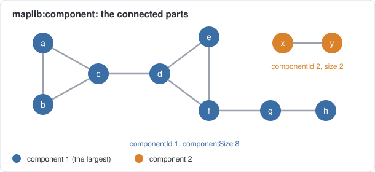
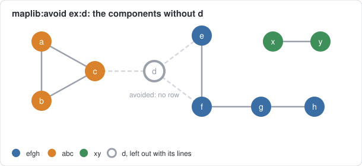
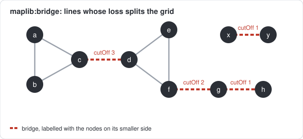
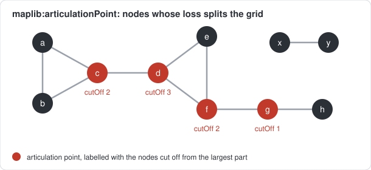

# maplib API usage guide

This guide walks through the maplib Python API by task, with an example for each public method of
`Model` and `ModelStream`, and for the module-level functions. The [README](README.md) has the
short overview, and each method's docstring (`help(Model.query)`) lists every parameter.

Features marked **EE** need maplib Enterprise Edition. In the open-source build they panic or raise
with "Contact Data Treehouse to try" (or raise `NotImplementedError`). Everything else works with
`pip install maplib`.

Contents:

1. [Conventions](#1-conventions)
2. [Creating a model](#2-creating-a-model)
3. [Templates](#3-templates)
4. [Mapping data](#4-mapping-data)
5. [Streaming with ModelStream](#5-streaming-with-modelstream)
6. [Reading and writing](#6-reading-and-writing)
7. [Named graphs and the transient graph](#7-named-graphs-and-the-transient-graph)
8. [Querying](#8-querying)
9. [SPARQL extensions](#9-sparql-extensions)
10. [Insert, update and federation](#10-insert-update-and-federation)
11. [User-defined functions and the query cache](#11-user-defined-functions-and-the-query-cache)
12. [Reasoning and validation](#12-reasoning-and-validation)
13. [Virtualization **EE**](#13-virtualization-ee)
14. [Configuration, serving and model management](#14-configuration-serving-and-model-management)

The examples use this prefix throughout:

```python
EX = "http://example.net/ns#"
```

## 1. Conventions

### Terms in results

Query results are Polars DataFrames, with one column per variable:

- **IRIs** are strings in angle brackets: `"<http://example.net/ns#alice>"`.
- **Blank nodes** are strings such as `"_:b0"`.
- **Literals** come back as native Polars values when a column holds a single datatype: `xsd:string`
  as `str`, `xsd:integer` as `i64`, `xsd:double` as `f64`, `xsd:boolean` as `bool`, `xsd:dateTime`
  as `datetime`, and so on. Language-tagged strings are formatted as `"hei"@no`.
- A column that **mixes types**, for example the `?o` of `?s ?p ?o`, holds formatted N-Triples-style
  strings: `"<http://...>"`, `"\"Alice\""`, `"\"30\"^^<http://www.w3.org/2001/XMLSchema#integer>"`.

Pass `solution_mappings=True` to `query` to get the DataFrame together with the RDF type of
each column (see [Round trips](#round-trips-with-solutionmappings)).

### Terms in input

When you map a DataFrame, IRI columns hold plain strings without brackets
(`"http://example.net/ns#alice"`). Whether a value becomes an IRI or a literal is decided by the
template's parameter type (`ottr:IRI`) or, without one, by the column's Polars type. The same holds
for `bindings=` and for the Python term classes:

```python
from maplib import IRI, Literal, BlankNode, Variable, Prefix, xsd, rdf, rdfs, owl, a

ex = Prefix(EX)
alice = ex.suf("alice")                 # IRI("http://example.net/ns#alice")
print(alice.iri)                        # http://example.net/ns#alice
age = Literal("30", data_type=xsd.integer)
print(age.to_native())                  # 30
greeting = Literal("hei", language="no")
b = BlankNode("b1")
print(xsd.string.iri, rdfs.label.iri, a.iri)   # the built-in namespaces hold IRIs
```

### Prefixes

`add_prefixes` registers prefixes for SPARQL queries and updates, Datalog rules and stOTTR
templates, so that you don't have to repeat `PREFIX` declarations:

```python
from maplib import Model

m = Model()
m.add_prefixes({"ex": EX})
m.reads(f"<{EX}alice> <{EX}name> \"Alice\" .", format="ntriples")
print(m.query("SELECT ?n WHERE { ex:alice ex:name ?n }"))
```

The common prefixes `rdf`, `rdfs`, `xsd`, `owl` and `ottr` are known in templates without
declaration. Template IRIs can be given as prefixed names, e.g. `m.map("ex:Person", df)`.

## 2. Creating a model

```python
from maplib import Model, IndexingOptions

m = Model()                              # everything in memory
```

A `Model` holds triples (in a default graph and any number of named graphs), templates, prefixes,
user-defined functions and settings.

### Storage modes

| `storage` | Dictionaries of IRIs and literals | Triple tables | Edition |
|---|---|---|---|
| `"memory"` (default) | memory | memory | open source |
| `"hybrid"` | disk | memory | **EE** |
| `"disk"` | disk | disk, as Parquet files | **EE** |

<!-- skip: EE -->
```python
m = Model(storage="disk", storage_folder="maplib_disk")    # EE
m = Model(storage_folder="maplib_disk")                     # EE: hybrid is the default with a folder
```

### Indexing options

`IndexingOptions` choose the indexes a model builds. Subjects are always indexed, and by default
`rdf:type` and `rdfs:label` also get object indexes, which make lookups by value fast.

```python
from maplib import IRI

m = Model(indexing_options=IndexingOptions(
    object_sort_some=[IRI(EX + "serialNumber")],   # object index for these predicates
))
# IndexingOptions(object_sort_all=True) indexes all suitable predicates (about twice the memory)
```

Full-text search (`fts=True`, `fts_predicates`, `fts_local_names`, `fts_iris`) and GeoSPARQL
(`geo=True`) are **EE**, see [section 9](#9-sparql-extensions). Use `create_index` to change the
indexes of an existing model ([section 14](#indexes-and-compaction)).

### Memory limit

Queries spill joins, aggregations, sorts and results to disk when maplib uses more memory than the
limit, which is 80% of the system memory by default (respecting container limits). The setting
applies to the whole process.

```python
import maplib

maplib.set_memory_limit(max_memory_mb=8000)
print(maplib.memory_limit())    # the limit, in bytes
print(maplib.memory_usage())    # the estimated bytes maplib has allocated
maplib.set_memory_limit()       # back to the defaults
```

`set_memory_limit` also takes `spill_dir` (set it before the first query: it is fixed at the
first spill), `max_spill_mb` (default 64 GB) and `abort_above_mb`, which stops the process with a
message on stderr before the operating system would kill it. Before that, a query raises a
`MemoryError` when the process uses more than 90% of `abort_above_mb`, which is checked as the
solutions of its joins are produced and between the steps of the query. Each call sets all four; arguments left as `None` get their defaults.

## 3. Templates

Templates are reusable patterns of triples in [OTTR](https://ottr.xyz/). Mapping a template with a
DataFrame instantiates it once per row, with each parameter taken from the column of the same name,
all rows at once.

### stOTTR syntax

```python
m = Model()
m.add_template("""
@prefix ex: <http://example.net/ns#> .
@prefix xsd: <http://www.w3.org/2001/XMLSchema#> .

ex:Person [
    ottr:IRI ?id,                     # typed: the values must be IRIs
    xsd:string ?name,
    ? xsd:integer ?age,               # optional: may be null
    ottr:IRI ?country = ex:Norway,    # default value, used when the value is null
    List<ottr:IRI> ?knows             # a list, from a Polars list column
] :: {
    ottr:Triple(?id, a, ex:Person),
    ottr:Triple(?id, ex:name, ?name),
    ottr:Triple(?id, ex:age, ?age),
    ottr:Triple(?id, ex:livesIn, ?country),
    cross | ottr:Triple(?id, ex:knows, ++?knows)
} .
""")
```

A template is `iri [ parameters ] :: { instances } .`. Each instance calls another template, and
`ottr:Triple(subject, predicate, object)` is the built-in base template. `a` stands for
`rdf:type`.

**Parameters** are `[modifiers] [type] ?name [= default]`:

| Part | Meaning |
|---|---|
| `?` before the type | optional: the value may be null (no triples are made from instances that need it) |
| `!` before the type | non-blank: the value may not be a blank node |
| type | `ottr:IRI`, a datatype such as `xsd:string`, `xsd:integer`, `xsd:dateTime`, `List<type>`, `NEList<type>` (non-empty list) or `LUB<type>`. Without a type it is taken from the data. |
| `= default` | a constant used when the value is null: an IRI, a literal (`"x"`, `2`, `"2"^^xsd:integer`) or a list (`("a", "b")`) |

Arguments of instances are variables, IRIs (full `<...>` or prefixed), literals (`"text"`,
`"text"@en`, `"1"^^xsd:integer`, `42`, `true`), blank nodes (`[]` or `_:b`) or lists (`(1, 2)`).
OTTR's `none` is not supported: leave an optional parameter null in the data instead.

**List expansion.** A list expander before an instance makes one instance per list element of the
arguments marked with `++`:

| Expander | With several `++` lists |
|---|---|
| `cross` | every combination of their elements |
| `zipMin` | element by element, stopping at the shortest list |
| `zipMax` | element by element, to the longest list (missing elements are null) |

```python
m.add_template("""
@prefix ex: <http://example.net/ns#> .
ex:Scores [ ottr:IRI ?id, List<ottr:IRI> ?tests, List<xsd:integer> ?scores ] :: {
    zipMin | ex:Score(?id, ++?tests, ++?scores)
} .
ex:Score [ ottr:IRI ?id, ottr:IRI ?test, xsd:integer ?score ] :: {
    ottr:Triple(?id, ex:took, ?test),
    ottr:Triple(?test, ex:score, ?score)
} .
""")
```

This also shows a **nested template call**: `ex:Scores` instantiates `ex:Score`, which is defined
in the same document. Templates may be defined in any order, and `add_template` replaces an
existing template with the same IRI.

Mapping the two templates:

```python
import polars as pl

people = pl.DataFrame({
    "id": [EX + "alice", EX + "bob"],
    "name": ["Alice", "Bob"],
    "age": [30, None],                              # Bob gets no ex:age triple
    "country": [None, EX + "Sweden"],               # Alice gets the default, ex:Norway
    "knows": [[EX + "bob"], []],                    # Bob knows nobody: no ex:knows triples
})
m.map("ex:Person", people)

scores = pl.DataFrame({
    "id": [EX + "alice"],
    "tests": [[EX + "t1", EX + "t2"]],
    "scores": [[90, 75]],
})
m.map("ex:Scores", scores)
print(m.query("SELECT ?test ?score WHERE { ?test <http://example.net/ns#score> ?score }"))
```

Templates can also be read from a file, or a URL of object storage:

```python
with open("templates.stottr", "w") as f:
    f.write("""@prefix ex: <http://example.net/ns#> .
ex:Named [ ottr:IRI ?id, ?label ] :: { ottr:Triple(?id, rdfs:label, ?label) } .""")
m.read_template("templates.stottr")
```

Syntax errors point at the offending source and suggest a fix:

```python
from maplib import MaplibException

try:
    m.add_template("""@prefix ex: <http://example.net/ns#> .
ex:T [ ?a ] :: { ottr:Triple(?a, ex:p, nothing) } .""")
except MaplibException as e:
    print(e)
# OTTR syntax error at line 2, column 39: `nothing` is not a valid term
# ...
#   = help: write a variable as `?nothing`, a prefixed name as `ex:nothing`, or a full IRI as ...
```

### Function calls in templates
Templates can compute their arguments with SPARQL functions, so that IRIs, casts and string or date manipulations are defined once in the template instead of in every data source. A function call is written Lisp-style, `(function argument ...)`, with the arguments separated by spaces, and can be used wherever a template argument can. The syntax and semantics follow Frog, an extension of OTTR with functions [3]:

```python
m = Model()
m.add_template("""
@prefix ex: <http://example.net/ns#> .

def ex:toIRI(xsd:string ?localName) -> ottr:IRI :: (
    IRI (CONCAT "http://example.net/" (ENCODE_FOR_URI ?localName))
) .

ex:Planet [ xsd:string ?name, ? xsd:string ?starName, xsd:string ?mass ] :: {
    ottr:Triple((ex:toIRI ?name), rdfs:label, ?name),
    ottr:Triple((ex:toIRI ?name), ex:orbits, (ex:toIRI ?starName)),
    ottr:Triple((ex:toIRI ?name), ex:mass, (xsd:decimal ?mass))
} .
""")
m.map("ex:Planet", pl.DataFrame({"name": ["11 Com b"], "starName": ["11 Com"], "mass": ["19.4"]}))
```

- Functions are the SPARQL built-in functions (`CONCAT`, `STR`, `IRI`, `REPLACE`, `UCASE`, `SUBSTR`, `YEAR`, `NOW`, `SHA256`, `IF`, `COALESCE`, `BOUND`, `IN`, ...; case insensitive), the operators `+ - * / = != < > <= >= && || !` (`+`, `*`, `&&` and `||` take two or more arguments), XSD casts such as `(xsd:integer ?x)`, functions registered as UDFs, and functions defined with `def` as above. Frog's base functions (`fn:plus`, `fn:concat`, `fn:castToIRI`, ... in `http://ns.frog.ottr.xyz/0.1/function/`) can be used where SPARQL has the same function. A call without arguments of a function given by an IRI must be written `(frog:functionCall ex:f)`, as `(ex:f)` is a list.
- Function calls are evaluated by maplib's SPARQL expression engine, for all rows at once, when the instance that contains them is expanded, before list expansion.
- As in SPARQL, errors give no value (`none`): then an optional parameter is left out, a parameter with a default value gets the default, and otherwise the instance is not expanded.
- Function calls can not be list expanded, and lists can not be function arguments. Functions defined with `def` can not be recursive, and their parameter and return types are documentation; maplib infers the types of the results from the data.
- From Python, use `FunctionCall`, e.g. `Triple(p, label, FunctionCall("UCASE", [name]))`.
- In the templates of virtualized resources (maplib Enterprise Edition), e.g. `ottr:Triple(?dp, ex:valueW, (* ?value 1000))`, function calls are evaluated on the rows the virtualized database returns. Filters on their values are evaluated by maplib, not pushed down.

Function calls follow Frog: M. Jarholt, "Frog: Functions for ontologies — An extension for the OTTR-framework", Master's thesis, University of Oslo, 2022, https://hdl.handle.net/10852/96925.

### Building templates in Python

The same templates can be built with `Template`, `Parameter`, `Variable`, `Argument`, `Instance`
and `Triple`:

```python
from maplib import Template, Parameter, Variable, Argument, Instance, Triple, RDFType, Prefix, xsd, a

ex = Prefix(EX)
pizza, country, ings = Variable("pizza"), Variable("country"), Variable("ingredients")

pizza_template = Template(
    iri=ex.suf("Pizza"),
    parameters=[
        Parameter(pizza, rdf_type=RDFType.IRI),               # RDFType.IRI is an attribute, not a call
        Parameter(country, optional=True, rdf_type=RDFType.IRI),
        Parameter(ings, rdf_type=RDFType.Nested(RDFType.IRI)),  # List<ottr:IRI>
    ],
    instances=[
        Triple(pizza, a, ex.suf("Pizza")),
        Triple(pizza, ex.suf("fromCountry"), country),
        Triple(pizza, ex.suf("hasIngredient"), Argument(ings, list_expand=True), list_expander="cross"),
    ],
)
print(pizza_template)   # prints the template as stOTTR

m = Model()
m.add_template(pizza_template)
m.map(pizza_template, pl.DataFrame({
    "pizza": [EX + "Hawaiian"],
    "country": [EX + "CAN"],
    "ingredients": [[EX + "Pineapple", EX + "Ham"]],
}))
```

- `Parameter(variable, optional=False, allow_blank=True, rdf_type=None, default_value=None)`.
  A plain `Variable` in the parameter list is an untyped, required parameter.
- `RDFType.IRI`, `RDFType.BlankNode`, `RDFType.Literal(xsd.string)`, `RDFType.Nested(t)` (a list)
  and `RDFType.Multi([...])` describe types.
- `Instance(iri, arguments, list_expander=None)` calls another template, and
  `template.instance(arguments, list_expander=None)` makes an instance of `template`. An argument
  of `None` is unbound.
- `Triple(s, p, o, list_expander=None)` is shorthand for an `ottr:Triple` instance.

```python
wrapper = Template(
    iri=ex.suf("CanadianPizza"),
    parameters=[pizza, ings],
    instances=[pizza_template.instance([pizza, ex.suf("CAN"), ings])],
)
m.add_template(wrapper)
m.map(wrapper, pl.DataFrame({"pizza": [EX + "Poutine"], "ingredients": [[EX + "Gravy"]]}))
```

### Inspecting templates

`get_templates` returns the templates of the model (without the built-in `ottr:Triple`), and
`templates_to_graph` writes them as RDF in the maplib template vocabulary, so their structure can
be queried with SPARQL:

```python
print([t.iri.iri for t in m.get_templates()])

m.templates_to_graph("urn:templates")
print(m.query("""
PREFIX maplib: <https://datatreehouse.github.io/maplib/vocab#>
SELECT ?template ?iri WHERE { ?template maplib:referencesIri ?iri }
""", graph="urn:templates"))
```

A `Template`'s `iri`, `parameters` and `instances` fields return copies; assign new lists to
change them.

> Printing (`print`/`repr`) a template that was parsed from stOTTR text currently panics with
> "not yet implemented". Templates built in Python print fine.

## 4. Mapping data

### map

`map(template, data=None, graph=None, validate_iris=True, stream=False)` instantiates a template
once per row. The template can be a `Template`, an `IRI`, an IRI string, a prefixed name or a
stOTTR document. `data` can be:

- a Polars `DataFrame`, with one column per parameter;
- a `LazyFrame`, consumed in one pass with `collect_batches()`, so it never needs to fit in memory;
- `SolutionMappings`, e.g. from `query(..., solution_mappings=True)`;
- an iterable of any of these, mapped batch by batch;
- nothing, for a template without parameters.

```python
m = Model()
m.add_template("""
@prefix ex: <http://example.net/ns#> .
ex:Reading [ ottr:IRI ?sensor, xsd:double ?value, xsd:dateTime ?at ] :: {
    ottr:Triple(?sensor, ex:value, ?value),
    ottr:Triple(?sensor, ex:at, ?at)
} .
""")
from datetime import datetime

df = pl.DataFrame({
    "sensor": [EX + "s1", EX + "s2"],
    "value": [1.5, 2.5],
    "at": [datetime(2024, 1, 1), datetime(2024, 1, 2)],
})
m.map("ex:Reading", df)                                   # the default graph
m.map("ex:Reading", df.lazy(), graph="urn:readings")      # a LazyFrame, into a named graph
m.map("ex:Reading", (df.slice(i, 1) for i in range(2)))   # an iterable of batches
```

Polars types map to XSD datatypes: `Utf8` to `xsd:string`, `Int64` to `xsd:long`, `Int32` to
`xsd:int`, `UInt32` to `xsd:unsignedInt`, `Float64` to `xsd:double`, `Boolean` to `xsd:boolean`,
`Datetime` to `xsd:dateTime`, `Date` to `xsd:date`, and `List` to lists. `Decimal` columns must have
precision 38 and scale 16 (`pl.Decimal(38, 16)`) to map to `xsd:decimal`. A typed parameter checks
the column, and `validate_iris=False` skips checking IRI columns.

### map_triples

`map_triples(data, predicate=None, graph=None, validate_iris=True, stream=False)` adds triples
straight from columns `subject`, `object` and, optionally, `predicate`:

```python
m = Model()
m.map_triples(pl.DataFrame({
    "subject": [EX + "alice", EX + "bob"],
    "object": [EX + "bob", EX + "carol"],
}), predicate=EX + "knows")
m.map_triples(pl.DataFrame({
    "subject": [EX + "alice"],
    "predicate": [EX + "name"],
    "object": ["Alice"],
}))
print(m.writes(format="ntriples"))
```

Strings in `subject` and `predicate` are IRIs. A string `object` column holds either only IRIs or
only literals: mixing them raises an error. Use a template when the object type needs to be explicit.

### map_default and generate_template

`map_default(data, primary_key_column)` maps a DataFrame without writing a template: it makes a
default template where the key column is the subject of one `ottr:Triple` per other column, with
predicates in the `urn:maplib_default:` namespace, adds it to the model, maps the data with it and
returns it. It takes `graph`, `validate_iris` and `stream` like `map`, and a LazyFrame or an
iterable of batches, where the template comes from the first batch with all parameters optional.

```python
df = pl.DataFrame({"id": [EX + "a", EX + "b"], "weight": [1.5, None], "label": ["A", "B"]})
template = m.map_default(df, "id")
```

`generate_template(data, primary_key_column)` is its dry run: it returns the same template without
mapping anything or adding it to the model. Review or edit it, then map with it:

```python
template = m.generate_template(df, "id")
print(template)          # ? xsd:double ?weight is optional, as the column has nulls
m.map(template, df)
```

### Façade-X: map_df, map_json and map_xml

`map_df`, `map_json` and `map_xml` map data generically, mirroring its structure with the
[Façade-X](https://sparql-anything.readthedocs.io/en/latest/Facade-X/) vocabulary
(`fx: <http://sparql.xyz/facade-x/ns/>`, keys and columns as `xyz: <http://sparql.xyz/facade-x/data/>`).
Query or `insert` CONSTRUCT queries to turn it into your own model.

```python
m = Model()
m.map_df(pl.DataFrame({"name": ["Alice", "Bob"], "age": [30, 40]}))   # one fx:child node per row
m.map_json('{"name": "Alice", "address": {"city": "Oslo"}, "tags": ["a", "b"]}')
m.map_xml('<root><person id="1"><name>Alice</name></person></root>')

print(m.query("""
PREFIX xyz: <http://sparql.xyz/facade-x/data/>
SELECT ?name ?city WHERE { ?r xyz:name ?name ; xyz:address/xyz:city ?city }
"""))
```

`map_json` and `map_xml` take a path, a string or an iterable of them (e.g. the lines of a JSON
Lines file), mapped one document at a time. `uuid_namespace` makes the generated IRIs reproducible
(UUID v5); document number `i` of an iterable then uses the namespace `<uuid_namespace>/<i>`. All
three take `graph=`.

```python
records = ['{"id": 1, "name": "Alice"}', '{"id": 2, "name": "Bob"}']
m.map_json(records, graph="urn:records", uuid_namespace="urn:records")
```

### CSV on the Web: map_csvw

`map_csvw(source, metadata=None, graph=None, minimal=False, iri_mappings=None)` converts CSV and
TSV files to RDF as the W3C [CSV on the Web](https://www.w3.org/TR/csv2rdf/) recommendations
specify. `source` is a metadata document or a tabular file: for a CSV file, maplib looks for
`<file>-metadata.json` or `csv-metadata.json` next to it, and otherwise uses the header row. It
returns the SPARQL Update it generated, so you can inspect or adapt it.

```python
import json

with open("trees.csv", "w") as f:
    f.write("id,species,height\n1,Oak,12.5\n2,Birch,8\n")
with open("trees.csv-metadata.json", "w") as f:
    json.dump({
        "@context": "http://www.w3.org/ns/csvw",
        "url": "trees.csv",
        "tableSchema": {
            "columns": [
                {"name": "id", "titles": "id", "datatype": "integer"},
                {"name": "species", "titles": "species"},
                {"name": "height", "titles": "height", "datatype": "decimal"},
            ],
            "aboutUrl": "http://example.net/tree/{id}",
            "propertyUrl": "http://example.net/ns#{_name}",
        },
    }, f)

m = Model()
update = m.map_csvw("trees.csv", minimal=True)    # minimal: only the triples of the cells
print(m.writes(format="turtle"))
# <http://example.net/tree/1> <http://example.net/ns#height> "12.5"^^xsd:decimal ;
#     <http://example.net/ns#id> "1"^^xsd:integer ; <http://example.net/ns#species> "Oak" . ...
```

Documents are never fetched over the network: `file:` IRIs are read directly, and
`iri_mappings={"https://example.org/data/": "local_folder"}` maps other IRIs to local folders.
Cells that don't match their datatype give Python warnings.

### Templates from an ontology: generate_templates

`maplib.generate_templates(m, graph=None, prefixes=None)` makes one template per class of an
ontology, from `rdfs:subClassOf`, `rdfs:domain`, `rdfs:range` (also through `owl:unionOf`),
`owl:Restriction` and the declared property types. The subject parameter is `id`. The other,
optional, parameters are named by the prefixed IRIs of the properties, e.g. `ex:flowRate`, so name
the DataFrame columns like that. `prefixes` gives the prefix names (common ones such as `rdfs` and
`skos` are known), and other namespaces get `ns1`, `ns2`, ... Properties whose range is the class
are included in reverse, with the suffix `_inverse`. Each class gets a template with the class IRI,
which also adds the `rdf:type` triple, and one suffixed `_notype` without it. Add all of them to the
model you populate, since subclass templates call the superclass templates.

```python
from maplib import generate_templates

ontology = Model()
ontology.reads("""
@prefix ex: <http://example.net/ns#> .
@prefix owl: <http://www.w3.org/2002/07/owl#> .
@prefix rdfs: <http://www.w3.org/2000/01/rdf-schema#> .
@prefix xsd: <http://www.w3.org/2001/XMLSchema#> .
ex:Pump a owl:Class .
ex:flowRate a owl:DatatypeProperty ; rdfs:domain ex:Pump ; rdfs:range xsd:double .
""", format="turtle")
templates = generate_templates(ontology, prefixes={"ex": EX})
print([p.variable.name for p in templates[EX + "Pump"].parameters])   # ['id', 'ex:flowRate']

m = Model()
for t in templates.values():
    m.add_template(t)
m.map(EX + "Pump", pl.DataFrame({"id": [EX + "p1"], "ex:flowRate": [12.0]}))
print(m.writes(format="turtle"))
```

### Copying triples between models: add_triples

`maplib.add_triples(source, target, source_graph=None, target_graph=None)` copies the triples of a
graph of one model into another, predicate by predicate. `Model.add_graph`
([section 7](#7-named-graphs-and-the-transient-graph)) does the same as a method.

```python
from maplib import add_triples

target = Model()
add_triples(m, target, target_graph="urn:copy")
print(target.size("urn:copy"))
```

### OPC UA NodeSets **EE**

<!-- skip: EE -->
```python
m.map_opc_ua("my_opc_ua_nodeset2_xmls", graph="urn:maplib:uagraphs")  # EE
```

The folder must contain the Namespace 0 NodeSet2 XML.

`m.opcua.add_typing_shapes(shapes_graph=None, type_namespaces=None, instance_namespaces=None)` generates
SHACL shapes from the type definitions in the mapped nodesets: a shape for each ObjectType and VariableType
(targeting the nodes with that `HasTypeDefinition`), one for each browse path of their fully inherited
instance declarations, and cardinality shapes requiring each Mandatory instance declaration exactly once.
Shapes of types with no instances are deactivated. All have `maplib:shapeCategory uamapper:OPCUATypingValidation`
(`uamapper:` is `https://github.com/DataTreehouse/uamapper#`). Give either the instance namespaces or the
type namespaces; without either, a namespace holds types when it has type nodes. The generation also adds
helper triples that your own shapes can use, such as `?ns uamapper:typeNamespace false` for instance namespaces.

<!-- skip: EE -->
```python
m.opcua.add_typing_shapes(shapes_graph="urn:shapes", instance_namespaces=["urn:my:instances"])
m.read("my_opc_ua_shapes.ttl", graph="urn:shapes")  # your own rules
report = m.validate(shape_graph="urn:shapes", report_graph="urn:report")
```

## 5. Streaming with ModelStream

`map`, `map_triples`, `map_json` and `map_xml` take `stream=True` and then return a lazy
`ModelStream` instead of mapping into the model. You add steps to it, each returning a new
`ModelStream`, and nothing runs until `collect()`:

| Step | Does |
|---|---|
| `.update(update, ...)` | a SPARQL Update, as `Model.update` |
| `.insert(construct, ...)` | inserts the results of a CONSTRUCT, as `Model.insert` |
| `.infer(rules, ...)` **EE** | Datalog inference, as `Model.infer` |
| `.write(path_or_file, format=None, graph=None, prefixes=None)` | appends the batch to a file: `"ntriples"` (default), `"turtle"` (prefixes declared once) or `"nquads"` |
| `.collect()` | runs the pipeline |

For each batch of the input, `collect()` maps the batch into a fresh in-memory model that has the
templates, prefixes and UDFs of the model, runs the steps in order, appends to the files, and drops
the batch model. Memory use depends on the batch size, not on the input size.

```python
m = Model()
m.add_prefixes({"ex": EX})
m.add_template("""
@prefix ex: <http://example.net/ns#> .
ex:Upper [ ottr:IRI ?s, ?u ] :: { ottr:Triple(?s, ex:upper, ?u) } .
""")
big = pl.DataFrame({"s": [f"{EX}n{i}" for i in range(10_000)], "u": [f"N{i}" for i in range(10_000)]})
batches = (big.slice(i, 1_000) for i in range(0, 10_000, 1_000))

(
    m.map("ex:Upper", batches, stream=True)
    .write("before.nt")
    .update("INSERT { ?s a ex:Node } WHERE { ?s ex:upper ?u }")
    .insert("CONSTRUCT { ?s ex:label ?u } WHERE { ?s ex:upper ?u }")
    .write("after.ttl", format="turtle")
    .collect()
)
print(m.size())   # 0: the model itself is unchanged
```

Things to know:

- Steps only see the triples of the current batch, so joins across batches find nothing. Split
  the input so that what belongs together is in one batch.
- Files are created (or truncated) when `collect()` starts. `write` also takes a binary file-like
  object, which is flushed but not closed. Iterators given as input are consumed.
- Blank node labels stay unique across batches.

A useful pattern is to map documents into the transient graph and write only what a CONSTRUCT
query makes from them:

```python
from maplib import TRANSIENT_GRAPH

with open("records.jsonl", "w") as f:
    f.write('{"name": "Alice"}\n{"name": "Bob"}\n')

records = """
PREFIX fx:  <http://sparql.xyz/facade-x/ns/>
PREFIX xyz: <http://sparql.xyz/facade-x/data/>
PREFIX ex:  <http://example.net/ns#>
CONSTRUCT { ?r a ex:Record ; ex:name ?name } WHERE { ?r a fx:root ; xyz:name ?name }
"""
with open("records.jsonl") as lines:
    (
        Model()
        .map_json(lines, graph=TRANSIENT_GRAPH, stream=True, documents_per_batch=1_000)
        .insert(records)
        .write("records.nt")
        .collect()
    )
print(open("records.nt").read())
```

## 6. Reading and writing

### Formats

| Format | `format=` | Read | Write |
|---|---|---|---|
| N-Triples | `"ntriples"` | yes (parallel) | yes |
| Turtle | `"turtle"` | yes (parallel) | yes, pretty-printed |
| N-Quads | `"nquads"` | yes (parallel) | yes |
| TriG | `"trig"` | yes | yes |
| RDF/XML | `"rdf/xml"` | yes | yes |
| JSON-LD | `"json-ld"` | yes | yes, compacted |
| HDT | `"hdt"` | yes | yes (`write` and `write_bytes`) |
| CIM/XML | `"cim/xml"` | **EE** | `write_cim_xml` **EE** |

Without `format`, it is taken from the file extension (`.nt`, `.ttl`, `.nq`, `.trig`, `.rdf`/`.xml`,
`.jsonld`, `.hdt`).

```python
m = Model()
m.reads(f"""
@prefix ex: <{EX}> .
ex:alice ex:name "Alice" ; ex:knows ex:bob .
""", format="turtle")

m.write("people.ttl", format="turtle", prefixes={"ex": EX})
m.write("people.nt")                         # format from the extension

m2 = Model()
m2.read("people.ttl")
m2.read("people.nt", graph="urn:copy", replace_graph=True)
s = m2.writes(format="ntriples", graph="urn:copy")
```

`read` and `reads` options:

- `graph=` reads into a named graph (for TriG, N-Quads and JSON-LD, the graphs named in the document
  are used when it is not given), and `replace_graph=True` replaces the graph's triples.
- `base_iri=` sets the base for relative IRIs.
- `parallel=` parses N-Triples, N-Quads and Turtle in parallel. It is on by default for N-Triples and
  N-Quads, and for Turtle it assumes that all prefixes come at the start of the document.
- `checked=False` skips IRI checks.
- `strict=True` raises on literals that don't parse as their datatype (e.g. `"abc"^^xsd:integer`).
  By default such triples are dropped with a warning.
- `triples_batch_size=` sets the number of triples read per batch.
- `known_contexts=` resolves JSON-LD contexts locally (see below).
- `geo=True` only applies to CIM/XML **EE**.

### Bytes and file-like objects

`read` also takes `bytes`, `bytearray`, `memoryview` or a file-like object with a `read` method
(text streams are read as UTF-8). `format` is then required, except for HDT, which is detected.
`write` takes a binary file-like object, and `write_bytes` returns bytes in any format:

```python
import io

hdt = m.write_bytes(format="hdt")
m3 = Model()
m3.read(hdt)                                 # HDT is detected

buf = io.BytesIO()
m.write(buf, format="ntriples")
m4 = Model()
m4.read(io.BytesIO(buf.getvalue()), format="ntriples")

with open("people.nt", "rb") as f:
    m4.read(f, format="ntriples")
```

### Object storage

`read`, `read_template`, `write`, `write_cim_xml`, `serialize` and `deserialize` take URLs of
Amazon S3 (`s3://bucket/path`), Google Cloud Storage (`gs://bucket/path`), Azure Blob Storage
(`az://container/path`, `abfss://container@account.dfs.core.windows.net/path`,
`https://account.blob.core.windows.net/container/path`), HTTP(S) and `file://`. Credentials come
from the environment as the cloud SDKs find them (e.g. `AWS_ACCESS_KEY_ID`,
`GOOGLE_APPLICATION_CREDENTIALS`, `AZURE_STORAGE_ACCOUNT_NAME` and `AZURE_STORAGE_ACCOUNT_KEY`), or from
`storage_options`, with the option names of Polars' `storage_options`:

<!-- skip: needs object storage -->
```python
m.read("s3://my-bucket/data/triples.ttl")
m.write("gs://my-bucket/out/triples.nt")
m.read("az://my-container/data.nt",
       storage_options={"azure_storage_account_name": "acc", "azure_storage_account_key": "..."})
```

Files that are read are downloaded to the system temporary folder first (set `TMPDIR` to change
it). Written objects are uploaded as they are written, and appear when the write completes.

### JSON-LD

Writing JSON-LD gives a compacted document with a `@context` of the prefixes used and one node
object per subject. `known_contexts` maps context URLs to their content when reading, so that
nothing is fetched:

```python
doc = '{"@context": "https://example.net/context.jsonld", "@id": "http://example.net/ns#alice", "name": "Alice"}'
ctx = '{"@context": {"name": "http://example.net/ns#name"}}'
m = Model()
m.reads(doc, format="json-ld", known_contexts={"https://example.net/context.jsonld": ctx})
print(m.writes(format="json-ld", prefixes={"ex": EX}))
```

### Several graphs in one file

For the dataset formats (JSON-LD, TriG and N-Quads), `graph` can be a list of graphs to write.
`maplib.DEFAULT_GRAPH` names the default graph in such a list. Without `graph`, TriG and N-Quads
write every graph except the transient graph.

```python
from maplib import DEFAULT_GRAPH

m = Model()
m.reads(f"<{EX}a> <{EX}p> <{EX}b> .", format="ntriples")
m.reads(f"<{EX}c> <{EX}p> <{EX}d> .", format="ntriples", graph="http://example.net/g1")
m.write("dataset.jsonld", format="json-ld", graph=[DEFAULT_GRAPH, "http://example.net/g1"])
m.write("dataset.trig", format="trig")       # all graphs
m.write("dataset.nq", format="nquads", graph=["http://example.net/g1"])
```

### serialize and deserialize

`serialize` saves the whole model in maplib's own Parquet-based format, by default as a single
file (`.maplib` by convention). This is much faster to load than RDF text. `Model.deserialize`
restores it, also into hybrid or disk storage **EE**.

```python
m.serialize("model.maplib")
m2 = Model.deserialize("model.maplib")
print(m2.size(), m2.size("http://example.net/g1"))

m.serialize("model_folder", single_file=False)   # a folder of Parquet files
m3 = Model.deserialize("model_folder")           # files and folders are both detected
```

<!-- skip: EE -->
```python
m.serialize("model.maplib", raw_db=True)                     # EE: DuckDB dictionaries, used in place
m = Model.deserialize("model.maplib", storage="disk", storage_folder="maplib_disk")   # EE
m.serialize("gs://my-bucket/models/model", single_file=False, raw_db=True)
m = Model.deserialize("gs://my-bucket/models/model", storage="disk",
                      storage_folder="/mnt/nvme/maplib", cache_size=200 * 2**30)    # EE
```

Serializing a folder to object storage writes a new generation folder and then publishes it
atomically, so readers see either the old or the new model. With `storage="disk"`, the triple
tables of such a folder are downloaded when they are first read, and `cache_size` bounds how much
of them is kept locally.

### CIM/XML **EE**

<!-- skip: EE -->
```python
PROFILE_GRAPH = "urn:graph:profiles"
m = Model()
m.read("model.xml", format="cim/xml", geo=True)     # EE; geo maps cim:Location to GeoSPARQL
m.read("61970-600-2_Equipment-AP-Voc-RDFS2020_v3-0-0.rdf", graph=PROFILE_GRAPH, format="rdf/xml")
m.write_cim_xml(
    "out.xml",
    profile_graph=PROFILE_GRAPH,
    description="MyModel",
    created="2023-09-14T20:27:41",
    scenario_time="2023-09-14T02:44:43",
    modeling_authority_set="www.example.org",
    version="22",
)
```

### Cutting a part of a CIM grid **EE**

The `cim` package of maplib Enterprise Edition cuts the grid around interior equipment out of a
model, stopping at border equipment, which is left out. The cut holds the equipment reached
through terminals and connectivity nodes (by default the normal topology: normally open switches
and equipment normally out of service are not passed), their terminals with connectivity nodes,
those connectivity nodes, and the resources they refer to up to `context_hops` (10) steps away
(containers, base voltages, locations, transformer ends, ...), but never other conducting
equipment, terminals or connectivity nodes. Every step is SPARQL that maplib evaluates:
`maplib:component` with `maplib:avoid` for the reachable topology, `maplib:shortestPath` for
`max_distance`, and INSERTs for the rest.

<!-- skip: EE -->
```python
from cim.scissors import cut_to_graph

m = Model()
m.read("EQ.xml", format="cim/xml", graph="urn:graph:eq")
m.read("GL.xml", format="cim/xml", graph="urn:graph:gl")
m.read("61970-600-2_Equipment-AP-Voc-RDFS2020_v3-0-0.rdf", format="rdf/xml", graph="urn:graph:rdfs")
counts = cut_to_graph(
    m,
    ["urn:uuid:busbar-in-the-area"],           # interior equipment
    ["urn:uuid:line-leaving-the-area"],        # border equipment, left out
    target_graph="urn:graph:cut",              # without it, nothing is written
    graphs=["urn:graph:eq", "urn:graph:gl", "urn:graph:rdfs"],   # None: the default graph
)
print(counts)   # members, equipment, terminals, connectivity_nodes, non_members, context,
                # boundary_equipment, triples
```

The `graphs` are read as one dataset, so the instance data, the `rdf:type` triples, the profiles
(EQ, SSH, TP, SV, GL) and the CIM vocabulary may each be in a graph of their own. The context
follows the CIM properties whose range is not an XML Schema datatype in the vocabulary (any CIM
predicate with IRI objects when there is none). `cim.cut(m, border_equipment_iris,
interior_equipment_iri, ...)` returns the cut as a Model of its own.

## 7. Named graphs and the transient graph

Most methods take `graph=` to work on a named graph instead of the default graph.

```python
m = Model()
m.reads(f"<{EX}a> <{EX}p> <{EX}b> .", format="ntriples")
m.reads(f"<{EX}b> <{EX}p> <{EX}c> .", format="ntriples", graph="urn:g1")

print(m.size(), m.size("urn:g1"))                                  # 1 1
print(m.query("SELECT * WHERE { ?s ?p ?o }", graph="urn:g1"))
print(m.query("SELECT * WHERE { GRAPH <urn:g1> { ?s ?p ?o } }"))   # GRAPH works too
```

`include_graphs` (in `query`, `update`, `insert`, `infer`, `get_predicate` and
`get_predicate_iris`) merges other graphs into the queried graph, as `FROM` does:

```python
print(m.query("SELECT ?s ?o WHERE { ?s <http://example.net/ns#p>+ ?o }", include_graphs=["urn:g1"]))
```

### TRANSIENT_GRAPH

`maplib.TRANSIENT_GRAPH` is a reserved graph for triples that should take part in querying,
validation and reasoning, but not be written: map, read or insert into it. Queries, updates,
inserts and inference include it by default (`include_graphs=None`); pass `include_graphs=[]` to
leave it out. Writing all graphs as TriG or N-Quads leaves it out; write it with
`graph=TRANSIENT_GRAPH`.

```python
from maplib import TRANSIENT_GRAPH

m.reads(f"<{EX}a> <{EX}helper> <{EX}x> .", format="ntriples", graph=TRANSIENT_GRAPH)
print(m.query("SELECT * WHERE { ?s <http://example.net/ns#helper> ?o }").height)    # 1
print(m.query("SELECT * WHERE { ?s <http://example.net/ns#helper> ?o }", include_graphs=[]).height)  # 0
print("helper" in m.writes(format="ntriples"))                                     # False
```

### Copying, detaching and emptying graphs

```python
other = Model()
other.reads(f"<{EX}x> <{EX}p> <{EX}y> .", format="ntriples")

m.add_graph(other, source_graph=None, target_graph="urn:g2")   # copy other's default graph into urn:g2
g1 = m.detach_graph("urn:g1")                     # urn:g1 becomes the default graph of a new Model
print(g1.size(), m.size("urn:g1"))                # 1 0
g2 = m.detach_graph("urn:g2", preserve_name=True) # keeps the graph name in the new model
m.truncate_graph()                                # empty the default graph
print(m.size())                                   # 0
```

## 8. Querying

`query(query, ...)` runs the four SPARQL 1.1 query forms: `SELECT`, `CONSTRUCT`, `ASK` and
`DESCRIBE`.

```python
m = Model()
m.add_prefixes({"ex": EX})
m.reads(f"""
@prefix ex: <{EX}> .
ex:alice ex:name "Alice" ; ex:age 30 ; ex:knows ex:bob .
ex:bob ex:name "Bob" ; ex:age 25 .
""", format="turtle")
```

### Return types

| Query | Returns |
|---|---|
| `SELECT` | a `DataFrame` |
| `CONSTRUCT` | a list of DataFrames with columns `subject`, `predicate`, `object`, one per predicate and type combination |
| `ASK` | a `bool` |
| `DESCRIBE` | as `CONSTRUCT`: a list of DataFrames with columns `subject`, `predicate`, `object` (see [DESCRIBE](#describe)) |

```python
df = m.query("SELECT ?p ?name ?age WHERE { ?p ex:name ?name ; ex:age ?age } ORDER BY ?age")
print(df)              # p: "<http://example.net/ns#bob>", name: "Bob", age: 25 ...
print(df["age"].sum()) # literals are native Polars values

triples = m.query("CONSTRUCT { ?p a ex:Adult } WHERE { ?p ex:age ?a FILTER(?a >= 18) }")
print(triples[0])

print(m.query("ASK { ex:alice ex:knows ex:bob }"))   # True
```

### DESCRIBE

`DESCRIBE` gives the triples whose subject is a described IRI, as a `CONSTRUCT` result. The
described IRIs are the constant IRIs after `DESCRIBE`, the IRIs the listed variables are bound to by
the `WHERE` pattern, or the IRIs every variable of the pattern is bound to with `DESCRIBE *`.
Blank nodes are not described, and triples where the resource is only the object are not included.

```python
print(m.query("DESCRIBE ex:alice"))                             # alice's name, age and knows triples
d = m.query("DESCRIBE ?p WHERE { ?p ex:age ?a FILTER(?a < 30) }")
print(sum(df.height for df in d))                               # 2: bob's name and age
d = m.query("DESCRIBE * WHERE { ex:alice ex:knows ?f }")        # bob's triples (?f is bob)
print(m.query("DESCRIBE ex:bob", return_format="turtle"))
```

`DESCRIBE` reads the queried graph (`graph=`, `include_graphs=` and `FROM` apply as for `CONSTRUCT`),
and the SPARQL endpoint of `Model.serve()` **EE** gives the same triples. `query_external` refuses
`DESCRIBE`.

### return_format

`return_format="json"` gives SPARQL JSON results (SELECT and ASK), and `"turtle"` gives Turtle
(CONSTRUCT and DESCRIBE):

```python
print(m.query("SELECT ?name WHERE { ?p ex:name ?name }", return_format="json"))
print(m.query("CONSTRUCT { ?p ex:label ?n } WHERE { ?p ex:name ?n }", return_format="turtle"))
```

### bindings

`bindings` binds variables to constant terms, for parameterised queries without string
formatting. Values are `IRI` or `Literal` objects, or strings in N-Triples syntax (`"<...>"`):

```python
from maplib import IRI, Literal, xsd

q = "SELECT ?name WHERE { ?p ex:name ?name ; ex:age ?age }"
print(m.query(q, bindings={"p": IRI(EX + "alice")}))
print(m.query(q, bindings={"p": "<http://example.net/ns#bob>"}))
print(m.query(q, bindings={"age": Literal("25", data_type=xsd.integer)}))
```

### Round trips with SolutionMappings

With `solution_mappings=True`, `query` returns a `SolutionMappings` with `mappings` (a DataFrame
in maplib's native encoding) and `rdf_types` (the RDF type of each variable). It can be mapped
straight back with a template, or passed as `parameters` to a query with `PVALUES`:

```python
sm = m.query("SELECT ?p ?name WHERE { ?p ex:name ?name }", solution_mappings=True)
print(sm.rdf_types)   # {'p': RDFType.IRI(), 'name': RDFType.Literal("http://www.w3.org/2001/XMLSchema#string")}

m.add_template("""
@prefix ex: <http://example.net/ns#> .
ex:Label [ ?p, ?name ] :: { ottr:Triple(?p, rdfs:label, ?name) } .
""")
m.map("ex:Label", sm)                         # types are kept

people = m.query("SELECT ?p WHERE { ?p ex:age ?a FILTER(?a > 26) }", solution_mappings=True)
print(m.query("SELECT ?p ?name WHERE { ?p ex:name ?name . PVALUES (?p) people }",
              parameters={"people": people}))
```

You can build `SolutionMappings(mappings, rdf_types)` yourself, too.

### graph, include_graphs and max_rows

`graph=` queries a named graph and `include_graphs=` merges others in ([section 7](#7-named-graphs-and-the-transient-graph)).
`max_rows=` fails a query whose estimated result is larger, which guards against running out of memory:

```python
try:
    m.query("SELECT * WHERE { ?a ?b ?c . ?d ?e ?f . ?g ?h ?i }", max_rows=10)
except Exception as e:
    print(type(e).__name__)
```

### debug

`debug=True` explains why a query has no results, by reporting the patterns that match nothing:

```python
m.query("SELECT ?x WHERE { ?x ex:nosuchpredicate ?y }", debug=True)
# The following triple pattern has no solution mappings: ?x <http://example.net/ns#nosuchpredicate> ?y
```

Ctrl-C stops a running query.

### Other endpoints: endpoint and query_external

`query(..., endpoint=url)` sends the query to a maplib server started with `Model.serve()` **EE**
and returns exactly what `query` returns on the served model (as Arrow over HTTP, with maplib's
types). `endpoint_token` gives the server's `auth_token`. `parameters` and `debug` can't be used
with an endpoint.

`query_external(query, endpoint, method="GET", ...)` runs a SELECT, CONSTRUCT or ASK query on any
SPARQL 1.1 endpoint and returns a DataFrame (or SolutionMappings, JSON or Turtle, as `query` does).
It refuses DESCRIBE. `headers` is a list of
`(name, value)` pairs.

<!-- skip: needs an external endpoint -->
```python
df = m.query_external("SELECT ?s WHERE { ?s ?p ?o } LIMIT 10",
                      "https://query.wikidata.org/sparql",
                      headers=[("User-Agent", "my-app/1.0")])
df = m.query("SELECT * WHERE { ?s ?p ?o } LIMIT 10", endpoint="http://127.0.0.1:7878/sparql")
```

## 9. SPARQL extensions

On top of SPARQL 1.1, maplib supports arithmetic and comparisons on durations, dates and times as
the XPath operators define them, e.g. `?end - ?start` giving an `xsd:dayTimeDuration`, and
`"P1D"^^xsd:dayTimeDuration = "PT24H"^^xsd:dayTimeDuration`.

```python
m = Model()
m.add_prefixes({"ex": EX, "xsd": "http://www.w3.org/2001/XMLSchema#"})
print(m.query("""
SELECT ?d WHERE {
    BIND("2024-03-01T12:00:00"^^xsd:dateTime - "2024-02-28T00:00:00"^^xsd:dateTime AS ?d)
}"""))
```

### Statistical aggregates

maplib has the statistical aggregates of Apache Jena ARQ, with the same names, namespace and
results, so queries run unchanged on both. They are in the Jena aggregate namespace
`http://jena.apache.org/ARQ/function/aggregate#`, and, as in Jena, also in the ARQ function
namespace `http://jena.apache.org/ARQ/function#` (`afn:stdev` and so on). Declare the prefix in the
query or with `add_prefixes`; it is not predefined.

| Aggregate | Computes | Fewest values |
|---|---|---|
| `agg:stdev`, `agg:stdev_samp` | sample standard deviation (divides by n - 1) | 2 |
| `agg:stdev_pop` | population standard deviation (divides by n) | 1 |
| `agg:variance`, `agg:var_samp` | sample variance | 2 |
| `agg:var_pop` | population variance | 1 |

```python
m = Model()
m.add_prefixes({"ex": EX, "agg": "http://jena.apache.org/ARQ/function/aggregate#"})
m.reads(f"""
@prefix ex: <{EX}> .
ex:pump1 ex:reading 10, 12, 11, 15 .
ex:pump2 ex:reading 7.5, 8.0 .
""", format="turtle")
print(m.query("""
SELECT ?pump (AVG(?r) AS ?mean) (agg:stdev(?r) AS ?sd) (agg:var_pop(DISTINCT ?r) AS ?var)
WHERE { ?pump ex:reading ?r } GROUP BY ?pump
"""))
```

* They work as other aggregates: with `DISTINCT`, in `HAVING`, in expressions such as
  `(MAX(?r) - AVG(?r)) / agg:stdev(?r)`, and as window functions, e.g.
  `agg:stdev(?r) OVER (PARTITION BY ?pump ORDER BY ?t ROWS BETWEEN 9 PRECEDING AND CURRENT ROW)`
  for a rolling standard deviation. Used outside an aggregation they are a syntax error.
* The result is an `xsd:double`. Values of any numeric datatype are converted to doubles, and a
  group may mix numeric datatypes. `DISTINCT` compares RDF terms, so `1` and `1.0` are both kept.
* A group with a value that is not numeric (a string, a boolean, an IRI, a date, ...) gives an
  error, so the result is unbound. So does a group with fewer values than the table says: no values
  at all, or a single value for the sample statistics. The population statistics of one value are
  `0.0`. Without GROUP BY over no solutions there is one solution with the result unbound.
* Unbound values (from OPTIONAL, or from an expression error) are skipped, as maplib does for SUM
  and AVG.

They are checked against Jena's own tests for them (`TestStatisticsAggregates`, ported in
`py_maplib/tests/test_statistical_aggregates.py`) and against Python's `statistics` module.
Jena's ARQ syntax keywords (`STDEV(?x)`, `AGG agg:stdev(?x)`) and its `MEDIAN` and `MODE`, which Jena
has only as keywords and not in the aggregate namespace, are not supported.

### XPath math functions: math:sqrt, math:pow, math:log, math:sin, ...

The trigonometric and exponential functions of XPath and XQuery Functions and Operators 3.1
([section 4.8](https://www.w3.org/TR/xpath-functions-31/#trigonometry)) are SPARQL functions in
their standard namespace, `PREFIX math: <http://www.w3.org/2005/xpath-functions/math#>`:

| Function | Value |
|---|---|
| `math:pi()` | π |
| `math:exp(x)`, `math:exp10(x)` | eˣ, 10ˣ |
| `math:log(x)`, `math:log10(x)` | the natural and the base 10 logarithm |
| `math:pow(x, y)` | xʸ (also a negative x with an integer y) |
| `math:sqrt(x)` | √x |
| `math:sin(x)`, `math:cos(x)`, `math:tan(x)` | x in radians |
| `math:asin(x)`, `math:acos(x)`, `math:atan(x)` | the angle in radians |
| `math:atan2(y, x)` | the angle of the point (x, y), in -π..π |

As the specification says, the arguments of any numeric datatype are cast to `xsd:double`, and the
result is an `xsd:double` that follows IEEE 754 (`math:sqrt(-1)` is `NaN`, `math:log(0)` is
`-INF`). An unbound argument, or one that is not a number, leaves the result unbound, as for the
other numeric functions of SPARQL. The apparent power of equipment from its active and reactive
power, and the current through a three-phase line from its power and voltage:

```python
m = Model()
m.add_prefixes({"ex": EX, "math": "http://www.w3.org/2005/xpath-functions/math#"})
m.reads(f"""
@prefix ex: <{EX}> .
ex:line1 ex:p 30.0 ; ex:q 40.0 ; ex:kv 132.0 .
""", format="turtle")
print(m.query("""
SELECT ?s ?amps WHERE {
    ?l ex:p ?p ; ex:q ?q ; ex:kv ?kv .
    BIND(math:sqrt(math:pow(?p, 2) + math:pow(?q, 2)) AS ?s)   # MVA: 50.0
    BIND(?s * 1000 / (math:sqrt(3) * ?kv) AS ?amps)            # A: about 218.7
}"""))
```

The distance in kilometres between two points by the haversine formula:

```sparql
BIND(math:pi() / 180 AS ?rad)
BIND(math:pow(math:sin((?lat2 - ?lat1) * ?rad / 2), 2)
     + math:cos(?lat1 * ?rad) * math:cos(?lat2 * ?rad)
       * math:pow(math:sin((?lon2 - ?lon1) * ?rad / 2), 2) AS ?h)
BIND(2 * 6371 * math:atan2(math:sqrt(?h), math:sqrt(1 - ?h)) AS ?km)
```

Every example of the specification is a test in `py_maplib/tests/test_xpath_math.py`, with the
special cases of `-0`, `INF` and `NaN`.

The path examples below use this graph: a chain `a -> b -> c -> d` and a shortcut `a -> d` with
cost on the nodes.

```python
m.reads(f"""
@prefix ex: <{EX}> .
ex:a ex:next ex:b . ex:b ex:next ex:c . ex:c ex:next ex:d . ex:a ex:jump ex:d .
ex:b ex:cost 1 . ex:c ex:cost 1 . ex:d ex:cost 5 .
""", format="turtle")
```

### Bounded paths: `{n,m}`

Any property path element can have bounds, as in Apache Jena: `elt{n}` (exactly n), `elt{n,m}`,
`elt{n,}` (n or more) and `elt{,m}` (0 to m). Each pair of nodes is returned once.

```python
print(m.query("SELECT ?o WHERE { ex:a ex:next{2,3} ?o }"))        # c and d
print(m.query("SELECT ?o WHERE { ex:a (ex:next|ex:jump){1} ?o }")) # b and d
```

### maplib:path

The magic predicate `maplib:path` (`PREFIX maplib: <https://datatreehouse.github.io/maplib/vocab#>`)
also returns the lengths, the paths and their nodes, and can rule out paths that revisit nodes.
Its subject is the start, and a blank node holds the options:

```python
m.add_prefixes({"maplib": "https://datatreehouse.github.io/maplib/vocab#"})
print(m.query("""
SELECT ?o ?len WHERE {
    ex:a maplib:path [
        maplib:predicate ex:next, ex:jump ;
        maplib:minLength 1 ;
        maplib:maxLength 3 ;
        maplib:object ?o ;
        maplib:length ?len
    ]
} ORDER BY ?o ?len"""))
```

| Option | Value | Default |
|---|---|---|
| `maplib:predicate` | IRI, can repeat: steps from subject to object | any predicate |
| `maplib:inversePredicate` | IRI, can repeat: steps from object to subject | |
| `maplib:minLength`, `maplib:maxLength` | non-negative integers | 1, unbounded |
| `maplib:object` | the end: a variable or a term | |
| `maplib:length` | variable: the number of steps | |
| `maplib:pathMode` | `"walk"`, `"acyclic"` (no repeated nodes) or `"simple"` (may end where it started) | `"walk"` |
| `maplib:shortest` | `true`: only the shortest length for each pair (all shortest paths with path outputs) | `false` |
| `maplib:pathIndex`, `maplib:nodeIndex`, `maplib:pathNode` | variables: one row per node of each path | |

Walks with `maplib:length` or path outputs need `maplib:maxLength` (or `maplib:shortest true`), as
a cycle gives walks of every length. To list the nodes of each path:

```python
print(m.query("""
SELECT ?path ?i ?node WHERE {
    ex:a maplib:path [
        maplib:predicate ex:next, ex:jump ;
        maplib:object ex:d ;
        maplib:maxLength 3 ;
        maplib:pathIndex ?path ; maplib:nodeIndex ?i ; maplib:pathNode ?node
    ]
} ORDER BY ?path ?i"""))
```

### maplib:shortestPath

`maplib:shortestPath` finds the shortest (or cheapest) paths from sources to targets. Its subject
is the source, and the options go on a node:

```python
print(m.query("""
SELECT ?target ?len ?nodes WHERE {
    ex:a maplib:shortestPath ?p .
    ?p maplib:predicate ex:next, ex:jump ;
       maplib:object ?target ;
       maplib:length ?len ;
       maplib:pathNodes ?nodes .
    VALUES ?target { ex:d }
}"""))   # 1 step, via ex:jump

print(m.query("""
SELECT ?cost ?nodes WHERE {
    ex:a maplib:shortestPath ?p .
    ?p maplib:predicate ex:next, ex:jump ;
       maplib:object ex:d ;
       maplib:weight ex:cost ;      # the cost of entering a node: Dijkstra
       maplib:cost ?cost ;
       maplib:kShortest 2 ;
       maplib:pathNodes ?nodes .
}"""))
```

The other patterns of the group give the sources, the targets (`maplib:object`) and the nodes to
avoid (`maplib:avoid`), or they are constants. An unbound `maplib:object` makes every node reached
a target. FILTERs apply after the search, so put a target filter in a nested group or subquery.

| Option | |
|---|---|
| `maplib:predicate`, `maplib:inversePredicate` | the edges, followed forwards and backwards (give a predicate as both for undirected edges) |
| `maplib:anyPredicate` `"forward"`/`"backward"`/`"both"`, `maplib:excludePredicate` | follow every predicate with IRI or blank node objects (except `rdf:type`), leaving out the excluded ones |
| `maplib:minLength`, `maplib:maxLength` | the fewest (default 1) and most edges |
| `maplib:limit` | the number of nearest targets per source |
| `maplib:weight`, `maplib:defaultWeight`, `maplib:maxCost` | a numeric predicate giving the cost of entering a node, the cost of nodes without it (default 0), and the highest cost |
| `maplib:avoid` | nodes that paths may start or end at, but not pass through |
| `maplib:kShortest` | the k shortest simple paths (Yen) |
| `maplib:allShortest`, `maplib:maxPaths` | all shortest paths, at most `maxPaths` (default 1000) |

Outputs: `maplib:length`, `maplib:cost`, `maplib:pathIndex`, `maplib:pathNodes` (a JSON array of
the nodes), and, for one row per node, `maplib:pathNode`, `maplib:nodeIndex`,
`maplib:stepPredicate` and `maplib:stepInverse`.

### Graph algorithms: maplib:component, maplib:bridge, maplib:articulationPoint

Three questions come up whenever a graph is a network (a power grid, a rail net, a supply chain,
a dependency graph): which parts hang together, which single link would split them, and which single
node would. maplib answers them with three magic predicates, so they are plain SPARQL that can be
combined with any other pattern, and run without changing or copying the model:

| Question | Predicate | Typical use |
|---|---|---|
| Which nodes are connected? | `?n maplib:component ?o` | islands, switch-bounded areas, what is still supplied |
| Which edges split their part when lost? | `?a maplib:bridge ?o` | lines without a backup, N-1 on lines |
| Which nodes split their part when lost? | `?n maplib:articulationPoint ?o` | single points of failure, N-1 on substations |

The examples use this small graph of `ex:line` edges: two triangles joined by `c - d`, a tail
`f - g - h`, and a separate pair `x - y`.

```python
m = Model()
m.add_prefixes({"ex": EX, "maplib": "https://datatreehouse.github.io/maplib/vocab#"})
m.reads(f"""
@prefix ex: <{EX}> .
ex:a ex:line ex:b . ex:b ex:line ex:c . ex:c ex:line ex:a .
ex:c ex:line ex:d .
ex:d ex:line ex:e . ex:e ex:line ex:f . ex:f ex:line ex:d .
ex:f ex:line ex:g . ex:g ex:line ex:h .
ex:x ex:line ex:y .
""", format="turtle")
```

The figures are drawn from maplib's own answers by `docs/images/graph_algorithms_figures.py`.

#### Connected components

`maplib:component` gives every node the number of its component (`maplib:componentId`, 1 for the
largest, then by decreasing size) and the component's size. The edges are followed in both
directions:



```python
print(m.query("""
SELECT ?node ?id ?size WHERE {
    ?node maplib:component ?c .
    ?c maplib:predicate ex:line ;
       maplib:componentId ?id ;
       maplib:componentSize ?size .
} ORDER BY ?id ?node"""))   # a to h: 1, 8; x and y: 2, 2
```

The options are on a blank node or a variable (`?c` above); `[ ... ]` works as well. Every
predicate below takes the same edge options.

#### What-ifs: maplib:avoid

`maplib:avoid` takes nodes out of the graph, with their edges, for this query only. It is a what-if
(open switches, equipment out of service, a closed station) without changing the model. The avoided
nodes have no row:



```python
print(m.query("""
SELECT ?node ?id WHERE {
    ?node maplib:component [
        maplib:predicate ex:line ; maplib:avoid ex:d ; maplib:componentId ?id
    ]
} ORDER BY ?id ?node"""))   # e, f, g, h: 1; a, b, c: 2; x, y: 3
```

`maplib:avoid` also takes a variable that the group binds, so the nodes to avoid can be found by a
query, e.g. every node marked as open. Put the patterns that find them in a subquery before the
magic predicate:

```python
m.reads(f"@prefix ex: <{EX}> . ex:d ex:open true .", format="turtle")
print(m.query("""
SELECT ?node ?id WHERE {
    { SELECT ?open WHERE { ?open ex:open true } }
    ?node maplib:component [ maplib:predicate ex:line ; maplib:avoid ?open ; maplib:componentId ?id ]
} ORDER BY ?id ?node"""))   # as above
```

#### Bridges

A bridge is an edge whose loss splits its component. `?a maplib:bridge ?o` gives one row per
bridge, with `maplib:object` binding the other end and `maplib:cutOff` the number of nodes on the
smaller side, which is how much the loss would cut off:



```python
print(m.query("""
SELECT ?a ?b ?cut WHERE {
    ?a maplib:bridge ?o .
    ?o maplib:object ?b ; maplib:predicate ex:line ; maplib:cutOff ?cut .
} ORDER BY DESC(?cut)"""))   # c-d 3, f-g 2, g-h 1, x-y 1
```

The edges of the triangles are not bridges, as each has a way around it. Parallel edges are not
bridges either. `maplib:edgePredicate` gives the predicate of the bridge's edge.

#### Articulation points

An articulation point is a node whose loss splits its component. `maplib:cutOff` is the number of
nodes no longer connected to the largest remaining part:



```python
print(m.query("""
SELECT ?n ?cut WHERE {
    ?n maplib:articulationPoint [ maplib:predicate ex:line ; maplib:cutOff ?cut ]
} ORDER BY DESC(?cut)"""))   # d 3, c 2, f 2, g 1
```

Losing `c` leaves `a, b` apart from `d` to `h` (2 cut off); losing `d` leaves `a, b, c` apart
from `e` to `h` (3 cut off).

#### Edges given by a query: maplib:edgeSource and maplib:edgeTarget

Often the edges of the network are not single triples. A power line connects the substations at its
two ends through terminals and connectivity nodes, for instance. `maplib:edgeSource ?a ;
maplib:edgeTarget ?b` make one edge of every distinct solution of the patterns that bind `?a` and
`?b`, so derived edges need no materialization. Put those patterns in a subquery:

```python
m.reads(f"""
@prefix ex: <{EX}> .
ex:l1 ex:from ex:p ; ex:to ex:q .
ex:l2 ex:from ex:q ; ex:to ex:r .
ex:l3 ex:from ex:q ; ex:to ex:r .
""", format="turtle")
print(m.query("""
SELECT ?line ?a ?b ?cut WHERE {
    { SELECT ?line ?a ?b WHERE { ?line ex:from ?a ; ex:to ?b } }
    ?a maplib:bridge ?o .
    ?o maplib:object ?b ; maplib:edgeSource ?a ; maplib:edgeTarget ?b ; maplib:cutOff ?cut .
}"""))   # l1 from p to q, cutting off 1; l2 and l3 are parallel, so neither is a bridge
```

The rows keep the other variables of the subquery (`?line` above), so a bridge comes back with the
line that makes it. A CIM grid's substation graph, with each line between the substations of its
two terminals:

```sparql
PREFIX cim: <http://iec.ch/TC57/CIM100#>
PREFIX maplib: <https://datatreehouse.github.io/maplib/vocab#>
SELECT ?line ?s1 ?s2 ?cut WHERE {
    { SELECT DISTINCT ?line ?s1 ?s2 WHERE {
        ?line a cim:ACLineSegment .
        ?t1 cim:Terminal.ConductingEquipment ?line ; cim:Terminal.ConnectivityNode ?n1 .
        ?t2 cim:Terminal.ConductingEquipment ?line ; cim:Terminal.ConnectivityNode ?n2 .
        ?n1 cim:ConnectivityNode.ConnectivityNodeContainer/cim:VoltageLevel.Substation ?s1 .
        ?n2 cim:ConnectivityNode.ConnectivityNodeContainer/cim:VoltageLevel.Substation ?s2 .
        FILTER(STR(?s1) < STR(?s2))   # each line once
    } }
    ?s1 maplib:bridge ?o .
    ?o maplib:object ?s2 ; maplib:edgeSource ?s1 ; maplib:edgeTarget ?s2 ; maplib:cutOff ?cut .
} ORDER BY DESC(?cut)
```

Every row is an edge, and two rows between the same nodes are parallel edges, which are never
bridges. A pattern that is symmetric in `?a` and `?b` (like the terminals above) gives each line
twice, once in each direction, so keep one direction with a filter such as
`FILTER(STR(?s1) < STR(?s2))`; two different lines between the same substations then stay
parallel, as they should. On the Nordic44 test grid this query gives 18 bridges.

The algorithms know nothing of CIM: the grid is only in the query, and the same predicates work on
rail nets, pipelines or call graphs.

#### Counting only some nodes, restricting the rows, and strong components

* `maplib:countNodes` takes nodes (a variable bound by the group, or constants) and makes only them
  count in `componentSize` and `cutOff`, e.g. the customers or substations cut off rather than every
  node of the graph.
* A subject bound by other patterns of the same block restricts the rows to those nodes. Nodes
  among them without edges are then components of their own.
* `maplib:strong true` gives the strongly connected components of the directed edges, which is
  what a cycle check or a dependency analysis needs.

| Predicate | Rows | Outputs |
|---|---|---|
| `?n maplib:component ?o` | one per node | `maplib:componentId`, `maplib:componentSize`; `maplib:strong true` gives strongly connected components of the directed edges |
| `?a maplib:bridge ?o` | one per bridge (an edge whose loss splits its component), `maplib:object ?b` binds the other end | `maplib:cutOff` (the nodes on the smaller side), `maplib:edgePredicate`, `maplib:componentId`, `maplib:componentSize` |
| `?n maplib:articulationPoint ?o` | one per node whose loss splits its component | `maplib:cutOff` (the nodes no longer connected to the largest remaining part), `maplib:componentId`, `maplib:componentSize` |

The edge options are those of `maplib:shortestPath` (`maplib:predicate`, `maplib:inversePredicate`,
`maplib:anyPredicate`, `maplib:excludePredicate`) or `maplib:edgeSource`/`maplib:edgeTarget`;
`maplib:avoid` and `maplib:countNodes` take a variable bound by the group (or a subquery before
it) or constants.

#### Speed and pitfalls

The algorithms run on the cached integer graph of `maplib:shortestPath`: union-find for
components, Tarjan's algorithms for strong components, bridges and articulation points, all
without recursion, so deep graphs do not overflow the stack. A grid of ten million triples answers
in well under a second.

Write the patterns that restrict the rows in the same block as the predicate, after a subquery of
avoided nodes. A separate block before the subquery is joined with it first, which is a cross
product.

#### Standards and compliance

No W3C or ISO standard defines these algorithms in a query language. SPARQL 1.1 and 1.2 have no graph
algorithms, and ISO GQL and SQL/PGQ leave them to vendor procedures. Other RDF stores also use their
own extensions, such as AnzoGraph's connected components SERVICE. maplib therefore follows the textbook
definitions (a bridge or an articulation point is an edge or a node whose removal increases the
number of connected components) and is checked against them. The tests in
`py_maplib/tests/test_graph_algorithms.py` cover the cases above, and
`py_maplib/tests/test_graph_algorithm_definitions.py` checks maplib on random graphs against the
definitions themselves, by removing every edge and every node in turn. Connected components are also
checked against the validation graphs of the [LDBC Graphalytics](https://github.com/ldbc/ldbc_graphalytics)
benchmark, which defines weakly connected components with reference outputs
(`py_maplib/tests/test_ldbc_graphalytics_wcc.py`).

### Full-text search: maplib:fts **EE**

Enable the index with `IndexingOptions(fts=True)` (or `create_index`), then search with the magic
predicate `maplib:fts`. Matching is case insensitive, with score 1.0 for a match of the whole
value and 0.75 for a substring match.

<!-- skip: EE -->
```python
m = Model(indexing_options=IndexingOptions(fts=True))      # EE
m.read("data.ttl")
df = m.query("""
PREFIX maplib: <https://datatreehouse.github.io/maplib/vocab#>
SELECT ?subj ?p ?object ?score WHERE {
    ?subj maplib:fts ?fts .
    ?fts maplib:ftsQuery "breaker" ;
         maplib:ftsLimit 10 ;
         maplib:ftsObject ?object ;
         maplib:ftsPredicate ?p ;
         maplib:ftsScore ?score .
}""")
```

`maplib:ftsUniqueSubject true` returns each subject once. `IndexingOptions(fts_predicates=[...])`
limits the index to some predicates. `fts_local_names=True` also indexes the local names of
subject IRIs, matched with the predicate `maplib:ftsLocalName`, and `fts_iris=True` indexes IRIs in the
object position.

### GeoSPARQL **EE**

With `IndexingOptions(geo=True)`, geometry literals (`geo:wktLiteral`, `geo:wkbLiteral`,
`geo:geoJSONLiteral`) are indexed spatially, and the GeoSPARQL functions are available: the simple
features, Egenhofer and RCC8 relations, measurements with units, constructions and serializations,
across coordinate reference systems. Spatial filters and joins use the index. `geof:relate`, the
query rewrite extension and the aggregates are not supported yet.

<!-- skip: EE -->
```python
m = Model(indexing_options=IndexingOptions(geo=True))      # EE
m.read("features.ttl")
df = m.query("""
PREFIX geo: <http://www.opengis.net/ont/geosparql#>
PREFIX geof: <http://www.opengis.net/def/function/geosparql/>
PREFIX rdfs: <http://www.w3.org/2000/01/rdf-schema#>
SELECT ?l WHERE {
    ?f rdfs:label ?l ; geo:hasGeometry/geo:asWKT ?g .
    FILTER(geof:sfWithin(?g, "POLYGON((1 1, 6 1, 6 6, 1 6, 1 1))"^^geo:wktLiteral))
}""")
```

## 10. Insert, update and federation

### insert

`insert(construct, ...)` runs a CONSTRUCT query and adds the triples. It returns the newly added
triples (those not already there) as a dict from predicate IRI to DataFrame. Run the same string
with `query` first to see what would be added:

```python
m = Model()
m.add_prefixes({"ex": EX})
m.reads(f"<{EX}hawaiian> <{EX}hasIngredient> <{EX}pineapple> .", format="ntriples")

controversial = "CONSTRUCT { ?p a ex:ControversialPizza } WHERE { ?p ex:hasIngredient ex:pineapple }"
print(m.query(controversial)[0])          # inspect
new = m.insert(controversial)             # commit
print(list(new))                          # ['http://www.w3.org/1999/02/22-rdf-syntax-ns#type']
print(m.insert(controversial))            # {}: nothing new
```

`source_graph=` is the graph the query reads, and `target_graph=` the graph the triples go to,
e.g. `TRANSIENT_GRAPH`. `solution_mappings=True` returns SolutionMappings. `include_graphs`,
`parameters`, `max_rows` and `debug` work as for `query`.

### update

`update(sparql_update, ...)` runs SPARQL 1.1 Update: `INSERT DATA`, `DELETE DATA`,
`INSERT`/`DELETE ... WHERE`, `DELETE WHERE`, `CLEAR`, `DROP`, `ADD`/`COPY`/`MOVE` and `LOAD`.

```python
m.update("""
DELETE { ?p ex:hasIngredient ex:pineapple }
INSERT { ?p ex:hasIngredient ex:mango }
WHERE  { ?p ex:hasIngredient ex:pineapple }
""")
m.update("INSERT DATA { GRAPH <urn:g> { ex:margherita a ex:Pizza } }")
m.update("INSERT { GRAPH ?g { ?p ex:inGraph true } } WHERE { GRAPH ?g { ?p a ex:Pizza } }")
print(m.query("SELECT ?p ?i WHERE { ?p ex:hasIngredient ?i }"))
```

`graph=`, `include_graphs`, `parameters`, `max_rows` and `debug` work as for `query`.

### Federation: SERVICE and LOAD

`set_federation(...)` enables SPARQL 1.1 Federated Query (`SERVICE`) and `LOAD` for the queries and
updates of the model, and replaces earlier settings:

```python
m.set_federation(
    allowed_endpoints=["https://query.wikidata.org/sparql", "http://localhost:7878"],  # by URL prefix
    headers={"https://query.wikidata.org": {"User-Agent": "my-app/1.0"}},
    timeout=60.0,
)
```

<!-- skip: needs an external endpoint -->
```python
df = m.query("""
PREFIX wdt: <http://www.wikidata.org/prop/direct/>
SELECT ?item ?label WHERE {
    VALUES ?item { <http://www.wikidata.org/entity/Q20> }
    SERVICE <https://query.wikidata.org/sparql> {
        ?item <http://www.w3.org/2000/01/rdf-schema#label> ?label FILTER(LANG(?label) = "en")
    }
}""")
```

A `SERVICE` pattern runs after the local patterns of its group. The distinct values that the
local patterns bind for the shared variables are sent with it, as `VALUES` blocks of `batch_size` rows
(a bind join), so the endpoint only returns matching solutions. `SERVICE SILENT` gives an empty solution
when the endpoint fails, and `SERVICE ?endpoint` queries the endpoints the variable is bound to.
With `allowed_endpoints=None` (the default) any http(s) URL is allowed, and `[]` allows none.
Other settings: `max_rows`, `concurrency`, `method` (`"POST"` or `"GET"`), and `bind_join=False` to
join locally. `arrow` and `arrow_batch_size` control the Arrow format used with maplib endpoints.

`LOAD <url> [INTO GRAPH <g>]` reads an RDF file from an http(s) URL, object storage, or a `file://`
URL listed in `allowed_endpoints`. It needs `allow_load=True`:

```python
import pathlib

pathlib.Path("extra.ttl").write_text(f"<{EX}x> <{EX}p> <{EX}y> .")
url = pathlib.Path("extra.ttl").resolve().as_uri()
m.set_federation(allowed_endpoints=[url], allow_load=True)
m.update(f"LOAD <{url}> INTO GRAPH <urn:loaded>")
print(m.size("urn:loaded"))   # 1
```

## 11. User-defined functions and the query cache

### add_udf and list_udfs

`add_udf(iri, func, output_type, input_types=None)` registers a Python function that SPARQL can
call by its IRI. The function gets a Polars DataFrame with one column per argument, named `"0"`,
`"1"` and so on. It returns the DataFrame with an added output column, or a Series. `output_type`
is an `RDFType` or a datatype IRI:

```python
from maplib import xsd, RDFType

def contains_abc(df: pl.DataFrame) -> pl.DataFrame:
    return df.with_columns(pl.col("0").str.contains("abc").alias("out"))

def shout(df: pl.DataFrame) -> pl.Series:
    return df["0"].str.to_uppercase() + "!"

m = Model()
m.reads(f'<{EX}a> <{EX}s> "xabcx" .\n<{EX}b> <{EX}s> "xyz" .', format="ntriples")
m.add_udf("urn:maplib:containsAbc", contains_abc, xsd.boolean, [xsd.string])
m.add_udf("urn:maplib:shout", shout, RDFType.Literal(xsd.string))
print(m.list_udfs())
print(m.query("""
SELECT ?x ?found ?loud WHERE {
    ?x <http://example.net/ns#s> ?s .
    BIND(<urn:maplib:containsAbc>(?s) AS ?found)
    BIND(<urn:maplib:shout>(?s) AS ?loud)
}"""))
```

### The query cache

`set_query_cache` keeps the results of `query` (and of `serve` **EE**). A result is kept until a write
changes triples it can read: writes are tracked per graph and predicate, so a write elsewhere
keeps it. It is off by default.

```python
from maplib import QueryCacheOptions

m.set_query_cache(QueryCacheOptions(max_entries=2048, ttl=None))   # or True for the defaults
q = "SELECT ?x WHERE { ?x <http://example.net/ns#s> ?s }"
m.query(q)                          # runs the query
m.query(q)                          # from the cache
print(m.query_cache_stats()["hits"])     # 1
print(m.get_query_cache().max_entries)   # 2048
m.query(q, cache=False)             # bypass it for one query
m.clear_query_cache()               # drop the results, keep the options
m.set_query_cache(False)            # turn it off
```

`QueryCacheOptions(enabled=True, max_entries=1024, max_bytes=256 MiB, max_entry_bytes=16 MiB,
ttl=None, min_run_time=0.0, cache_virtualized=False)`. Queries with `parameters` or `debug`, and
queries calling `NOW()`, `RAND()`, `UUID()`, `STRUUID()`, `BNODE()` or UDFs, are never cached.
Results over virtualized databases are only kept with `cache_virtualized=True`, and then a `ttl`
should be set.

## 12. Reasoning and validation

### infer_rdfs

`infer_rdfs(graph=None)` applies the RDFS rules 2, 3, 5, 6, 7, 8, 9, 10 and 11 (domain, range,
subproperties and subclasses). The inferred triples go in the transient graph, so they can be
queried but are not written. It returns the number of inferred triples.

```python
m = Model()
m.reads(f"""
@prefix ex: <{EX}> .
@prefix rdfs: <http://www.w3.org/2000/01/rdf-schema#> .
ex:Dog rdfs:subClassOf ex:Animal .
ex:owns rdfs:range ex:Thing .
ex:rex a ex:Dog .
ex:alice ex:owns ex:rex .
""", format="turtle")
print(m.infer_rdfs())
print(m.query("SELECT ?t WHERE { <http://example.net/ns#rex> a ?t }"))   # Dog, Animal, Thing
```

### Datalog: infer **EE**

`infer(rulesets, graph=None, max_iterations=100_000, include_graphs=None, max_rows=100_000_000,
debug=False)` runs Datalog rules to a fixpoint and adds the inferred triples. With `profile=`
instead of rulesets, it runs a built-in reasoning profile, see the next section. A rule is
`head :- body .`, with triple patterns written `[subject, predicate, object]`:

<!-- skip: EE -->
```python
rules = """
PREFIX ex: <http://example.net/ns#>
[?a, ex:ancestor, ?b] :- [?a, ex:parent, ?b] .
[?a, ex:ancestor, ?c] :- [?a, ex:parent, ?b], [?b, ex:ancestor, ?c] .
[?p, ex:category, "adult"] :- [?p, ex:age, ?age], FILTER(?age >= 18) .
"""
result = m.infer(rules)          # EE; also takes a list of rulesets
```

Bodies can use `FILTER(...)`, `BIND(expr AS ?v)` and `AGGREGATE(... ON ?group BIND SUM(?x) as ?s)`.
A ruleset can also consist of SPARQL `CONSTRUCT` queries, which are run as rules. Prefixes added with
`add_prefixes` are known in rules. `debug=True` reports rule bodies that give no triples.

### Reasoning profiles: infer(profile=...) **EE**

`infer(profile="owl-rl", graph=None, target_graph=None, include_graphs=None, max_violations=1000,
max_rows=100_000_000)` materializes the entailments of a built-in reasoning profile with the Datalog
engine. The schema (classes, properties, restrictions and lists) is compiled into rules, which run to
a fixpoint. The profiles are:

- `"owl-rl"`: the OWL 2 RL/RDF rules of OWL 2 Profiles: equality, property axioms (inverse,
  symmetric, transitive, functional, inverse functional, property chains, keys), class expressions
  (intersection, union, one of, some, all and has value, max (qualified) cardinality 1), class
  axioms and schema rules. The rules that conclude `false` are checked after inference and
  reported as violations. Not included: `x owl:sameAs x` for every term (eq-ref) and the datatype
  rules dt-type2, dt-eq, dt-diff and dt-not-type.
- `"rdfs-plus"`: a cheaper preset: domain, range, subproperties and subclasses, plus
  `owl:inverseOf`, symmetric and transitive properties, `owl:equivalentClass`,
  `owl:equivalentProperty`, `owl:sameAs` and functional and inverse functional properties. It adds
  no axiomatic or reflexive triples and checks nothing.
- `"rdfs"`: all the RDFS entailment rules of RDF 1.1 Semantics (rdfD2, rdfs1 to rdfs13) with the
  RDF and RDFS axiomatic triples, except rdfs4a, rdfs4b and the axiomatic triples that would make
  every term an `rdfs:Resource`.

Parameters:

- `graph`: the graph to reason over, the default graph by default.
- `target_graph`: where the inferred triples go. By default the transient graph, so they can be
  queried but are not written. There is one transient graph, shared by all graphs and included in
  queries by default, so when you reason over several named graphs separately, give each its own
  target graph. Pass `DEFAULT_GRAPH` (or the graph itself) to add the triples to it. Triples that
  are already in the graph are not added again.
- `include_graphs`: graphs read along with the graph, as with FROM. `None` includes the transient
  graph, `[]` reads only the graph itself and the target graph.
- `max_violations`: the most violations reported per rule; `0` skips the consistency checks.
- `max_rows`: the most estimated rows in the result of a rule, to avoid running out of memory.

It returns a `ReasoningResult` with `profile`, `inferred_triples`, `consistent`, `violations` (a
list of dicts with `rule`, `message` and `nodes`), `violations_truncated`, `rounds`, `rules`,
`rule_executions` and `seconds`.

<!-- skip: EE -->
```python
m = Model()
m.reads("""
@prefix ex: <http://example.org/> .
@prefix owl: <http://www.w3.org/2002/07/owl#> .
ex:partOf a owl:TransitiveProperty ; owl:inverseOf ex:hasPart .
ex:Breaker owl:disjointWith ex:Transformer .
ex:bay1 ex:partOf ex:substation1 . ex:substation1 ex:partOf ex:region1 .
ex:b1 a ex:Breaker, ex:Transformer .
""", format="turtle")
res = m.infer(profile="owl-rl")   # EE
print(res.inferred_triples, res.consistent)   # consistent is False
for v in res.violations:
    print(v["rule"], v["message"])            # cax-dw: ex:b1 is an instance of the disjoint classes ...
print(m.query("SELECT ?x WHERE { <http://example.org/region1> <http://example.org/hasPart> ?x }"))
# bay1 and substation1, through transitivity and the inverse property
```

Choosing between them: `infer_rdfs` is in the open-source core. It runs the RDFS rules once each,
in order, as SPARQL inserts, which is fast and enough for typical class and property hierarchies.
`infer(profile="rdfs")` computes the complete RDFS closure (for example, types from domains of
subproperties found late), with the axiomatic triples, on the Datalog engine. `infer(profile="rdfs-plus")`
adds the common OWL property axioms and equality without the cost of axiomatic triples or checks;
use it for inverse and transitive properties in models such as CIM. Use `infer(profile="owl-rl")` for
class expressions, property chains, keys and consistency checks.

Inferring or asserting `owl:sameAs` is costly for large groups of equal resources, because the
triples of every member are copied to the others.

### SHACL: validate **EE**

`validate(...)` validates a graph against SHACL Core and SHACL-SPARQL shapes, evaluating shapes in
parallel, and runs SHACL rules (`sh:rule`):

<!-- skip: EE -->
```python
m = Model()
m.reads("""
@prefix sh: <http://www.w3.org/ns/shacl#> .
@prefix ex: <http://example.org/> .
ex:PersonShape a sh:NodeShape ; sh:targetClass ex:Person ;
    sh:property [ sh:path ex:name ; sh:minCount 1 ; sh:message "Missing name"@en ] .
""", format="turtle", graph="urn:shapes")
m.reads("@prefix ex: <http://example.org/> . ex:alice a ex:Person .", format="turtle")

report = m.validate(shape_graph="urn:shapes", report_graph="urn:report")   # EE
print(report.conforms)          # False
print(report.results())         # one row per result; message is a list of strings
print(report.shape_targets)     # targets per shape and constraint
print(report.performance)
```

Options: `data_graph`, `report_graph` (`""` (the default) writes no report graph, `None` writes it
to the default graph), `inferences_graph` (for `sh:rule` results, otherwise the transient graph),
`include_details=True` (then `report.details()`), `include_conforms`, `only_shapes` /
`deactivate_shapes`, `dry_run` (only find the targets), `max_rows`, `serial`, `max_iterations` and
`debug_rules` (with `report.rule_log`).

## 13. Virtualization **EE**

Virtualization leaves large time series in the database that holds them. The graph describes the
time series, and the parts of a SPARQL query that read their data points are translated to the
database's query language. Filters, grouping and ordering are pushed down where possible.

### VirtualizedDatabase and add_virtualization

Each time series in the graph has `chrontext:hasResource` (the name of a resource) and
`chrontext:hasExternalId` (its id in the database). A resource has a template describing its
rows, which must have an `id` parameter:

<!-- skip: EE -->
```python
from maplib import Model, VirtualizedDatabase, Template, Parameter, Variable, RDFType, Triple, Prefix, xsd
from maplib.virtualization import DuckDBDatabase

ct = Prefix("https://github.com/DataTreehouse/chrontext#")
id_, ts, value, dp = Variable("id"), Variable("timestamp"), Variable("value"), Variable("dp")
readings = Template(
    iri=ct.suf("readings"),
    parameters=[
        Parameter(id_, rdf_type=RDFType.Literal(xsd.string)),
        Parameter(ts, rdf_type=RDFType.Literal(xsd.dateTime)),
        Parameter(value, rdf_type=RDFType.Literal(xsd.double)),
    ],
    instances=[
        Triple(id_, ct.suf("hasDataPoint"), dp),     # name the data point with a variable, not a blank node
        Triple(dp, ct.suf("hasValue"), value),
        Triple(dp, ct.suf("hasTimestamp"), ts),
    ],
)
vdb = VirtualizedDatabase(
    DuckDBDatabase(database="readings.duckdb"),
    resource_sql_map={"readings": "SELECT sensor_id AS id, ts AS timestamp, value FROM readings"},
)
m = Model()
m.reads("""
@prefix ct: <https://github.com/DataTreehouse/chrontext#> .
@prefix ex: <http://example.net/ns#> .
ex:pump1 ex:hasSensor ex:s1 . ex:s1 ct:hasTimeseries ex:ts1 .
ex:ts1 ct:hasResource "readings" ; ct:hasExternalId "sensor-1" .
""", format="turtle")
m.add_virtualization(vdb, resources={"readings": readings})      # EE
df = m.query("""
PREFIX ct: <https://github.com/DataTreehouse/chrontext#>
PREFIX ex: <http://example.net/ns#>
PREFIX xsd: <http://www.w3.org/2001/XMLSchema#>
SELECT ?pump (AVG(?v) AS ?avg) WHERE {
    ?pump ex:hasSensor/ct:hasTimeseries ?t .
    ?t ct:hasDataPoint ?p . ?p ct:hasTimestamp ?at ; ct:hasValue ?v .
    FILTER(?at >= "2024-01-01T00:00:00Z"^^xsd:dateTime)
} GROUP BY ?pump""")
```

- `VirtualizedDatabase(database, resource_sql_map=None, sql_dialect=None, pushdowns=None)`: any
  object with a `query(sql) -> pl.DataFrame` method works as the database, given a `sql_dialect`
  (`"duckdb"`, `"postgres"`, `"snowflake"`, `"bigquery"`, `"databricks"` or an `SQLDialect`). The SQL
  of a resource can be a string, an SQLAlchemy `Table` or `Select`. Without `resource_sql_map`, the
  `query` method gets the `VirtualizedQuery` itself (`maplib.vq`) to translate.
- `pushdowns` chooses among `"value_conditions"`, `"group_by"` and `"ordering"`.
- `add_virtualization` can be called several times to query several databases together. Joins
  between time series are only pushed down within one database.
- `VirtualizedDatabase.Cognite(client, resource_cognite_map=None)` reads time series from Cognite
  Data Fusion.

### maplib.virtualization

Ready-made databases, which know their dialect: `DuckDBDatabase`, `SnowflakeDatabase`,
`BigQueryDatabase`, `DatabricksDatabase`, `TimescaleDatabase`, `InfluxDBDatabase` (InfluxDB 3, SQL),
`InfluxDB2Database` (InfluxDB 2 / 1.8, Flux; resources are measurements),
`FabricLakehouseDatabase`, `FabricDatabase` (Fabric Warehouse, T-SQL) and `KustoDatabase` (Azure
Data Explorer and Fabric Eventhouses; resources are KQL expressions). `SQLDatabase` is the base class
for your own. The dialect classes (`PostgresDialect`, `DuckDBDialect`, `SnowflakeDialect`, ...),
`translate_sql` and `translate_kql` let you customise or inspect the generated queries.
`maplib.opcua.OPCUAHistoryDatabase(endpoint, ...)` reads OPC UA Historical Access, with node ids
such as `ns=2;s=ts1` as external ids.

<!-- skip: EE -->
```python
from maplib.virtualization import SnowflakeDatabase
from maplib.opcua import OPCUAHistoryDatabase

snow = VirtualizedDatabase(
    SnowflakeDatabase(account="...", user="...", warehouse="...", database="...", schema="..."),
    resource_sql_map={"readings": "SELECT sensor_id AS id, ts AS timestamp, value FROM readings"},
)
opcua = VirtualizedDatabase(database=OPCUAHistoryDatabase("opc.tcp://plant:4840/"))
m.add_virtualization(snow, resources={"readings": readings})
m.add_virtualization(opcua, resources={"history": readings})
```

### Industrial sources: map_cdf, map_osipi, map_pi_points, map_insights_hub and maplib.ip21

These read a source's own asset model into the graph and virtualize its time series in one call.
Their docstrings describe the vocabulary each one produces.

<!-- skip: EE -->
```python
from cognite.client import CogniteClient
m.map_cdf(CogniteClient(), data_models=[("my_space", "MyModel", "v1")])     # Cognite Data Fusion

m.map_osipi("https://myserver/piwebapi", asset_database="\\\\MyAFServer\\MyDatabase",
            username="me", password="...")                                  # PI Asset Framework
m.map_pi_points("https://myserver/piwebapi", data_server="MyPIServer", name_filter="FIC*",
                username="me", password="...")                             # PI Data Archive tags
m.map_insights_hub("gateway.eu1.mindsphere.io", "mytenant",
                   client_id="mytenant-svc", client_secret="...")           # Siemens Insights Hub

from maplib.ip21 import map_ip21
map_ip21(m, "https://ip21server/ProcessData/AtProcessDataREST.dll", "IP21",
         tag_filter="FIC*", default_start_time="2024-01-01T00:00:00Z")      # AspenTech IP.21
```

Their data points are queried like any other virtualized time series:

<!-- skip: EE -->
```python
df = m.query("""
PREFIX osipi: <urn:maplib_osipi:>
PREFIX chrontext: <https://github.com/DataTreehouse/chrontext#>
PREFIX xsd: <http://www.w3.org/2001/XMLSchema#>
SELECT ?tag ?bucket (AVG(?v) AS ?avg) WHERE {
    ?p a osipi:Point ; osipi:name ?tag ; chrontext:hasDataPoint ?dp .
    ?dp chrontext:hasTimestamp ?t ; chrontext:hasValue ?v .
    BIND(chrontext:FloorDateTimeToSecondsInterval(?t, 3600) AS ?bucket)
    FILTER(?t >= "2024-01-01T00:00:00Z"^^xsd:dateTime && ?t < "2024-01-02T00:00:00Z"^^xsd:dateTime)
} GROUP BY ?tag ?bucket""")
```

Grouping by `chrontext:FloorDateTimeToSecondsInterval` with MIN, MAX, SUM, COUNT or AVG is read
from the source's own aggregates where it has them. A query without a lower bound on the timestamp
fails unless `default_start_time` is set.

## 14. Configuration, serving and model management

### maplib.config

`maplib.config` keeps a model's configuration as triples in its own named graph,
`maplib.config.CONFIG_GRAPH`, so the configuration is written, serialized and served with the model.
`apply_config(m)` applies it: it creates the indexes, sets the query cache and connects the
virtualizations. Secrets are never stored: a secret names the environment variable that holds it.
[CONFIG_GRAPH.md](CONFIG_GRAPH.md) documents the vocabulary.

```python
from maplib.config import (
    CONFIG_GRAPH, IndexingConfig, QueryCacheConfig,
    write_indexing, read_indexing, write_query_cache, read_query_cache, remove_query_cache,
    apply_query_cache, apply_config,
)

m = Model()
write_query_cache(m, QueryCacheConfig(max_entries=2048, ttl=300.0))
write_indexing(m, IndexingConfig(object_sort_some=["http://example.net/ns#serialNumber"]))
print(read_query_cache(m), read_indexing(m))
m.write("model.trig", format="trig")      # the config graph is in the file

m2 = Model()
m2.read("model.trig")
apply_config(m2)                          # sets the cache and creates the indexes
print(m2.get_query_cache().max_entries)   # 2048
```

Virtualizations **EE** are configured the same way:

<!-- skip: EE -->
```python
from maplib.config import VirtualizationConfig, VirtualizationResource, write_virtualization, read_virtualizations

write_virtualization(m, VirtualizationConfig(
    iri="urn:maplib:config:virtualization:readings",
    database="snowflake",                  # one of maplib.config.DATABASES
    parameters={"account": "acme", "user": "maplib", "warehouse": "wh", "database": "meters", "schema": "public"},
    secrets={"password": "SNOWFLAKE_PASSWORD"},          # read from the environment by apply_config
    resources=[VirtualizationResource(
        name="readings",
        sql="SELECT id, ts AS timestamp, value FROM readings",
        template=READINGS_TEMPLATE,                     # a stOTTR document or a template IRI
        properties={"http://iec.ch/TC57/2013/CIM-schema-cim16#Measurement.unitSymbol":
                    "http://iec.ch/TC57/2013/CIM-schema-cim16#UnitSymbol.W"},
    )],
))
applied = apply_config(m)                 # EE; apply_config(m, environ={...}) for other secret sources
```

Other functions: `remove_virtualization`, `read_virtualizations`, `apply_virtualization`,
`apply_properties` (writes the static resource properties without connecting) and `probe(config)`,
which checks a configuration against the database without changing a model.

### serve **EE**

`serve(...)` serves the live model over the SPARQL 1.1 Protocol (`/sparql`, `/query`, `/update`,
`/store`), the Arrow API over HTTP (`/arrow/...`) and Arrow Flight, in the background. Queries see
changes made from Python, and the other way round.

<!-- skip: EE -->
```python
import pyarrow.flight

server = m.serve(port=7878, flight_port=7879, allow_update=True, auth_token="secret")   # EE
print(server.url)            # http://127.0.0.1:7878/sparql
df = Model().query("SELECT * WHERE { ?s ?p ?o } LIMIT 5", endpoint=server.url, endpoint_token="secret")
client = pyarrow.flight.connect(server.flight_url)
server.stop()

with m.serve(port=0, flight_port=None) as server:   # stops on exit
    ...
```

Options include `host` (use `"0.0.0.0"` with `auth_token`), `cors_origins`, `graph` and
`include_graphs`, `max_rows`, `max_request_bytes`, `arrow_compression`, `query_log_size` (served at
`GET /query-log`), `static_dir`/`static_path`/`static_vars` for a web app, `query_cache`,
`service_endpoints` and `allow_load` (SERVICE and LOAD are refused unless listed), and `block=True`.

### explore **EE**

`explore()` runs the Model portal, a browser UI for browsing, searching and querying the model.

<!-- skip: EE -->
```python
server = m.explore(port=8000)     # EE
print(server.url)                 # open it in a browser
print(server.sparql_url)          # the portal's SPARQL endpoint
server.stop()
```

The module-level `maplib.explore(m, ...)` is deprecated; use `m.explore()`.

### Indexes and compaction

```python
from maplib import IndexingOptions, IRI

m = Model()
m.reads(f'<{EX}a> <{EX}serialNumber> "123" .', format="ntriples")
m.create_index(IndexingOptions(object_sort_some=[IRI(EX + "serialNumber")]))
m.compact()     # merge the segments that accumulate from repeated additions
```

`create_index` sets the indexing options and builds the indexes for the triples already in the
model, dropping object indexes that are no longer chosen. Full-text and geo indexes are **EE**.
`compact` merges the stored segments of each predicate into one sorted segment. `serialize`
also compacts the model.

### Introspection

```python
print(m.size())                                   # triples in the default graph
print(m.get_predicate_iris())                     # [IRI(http://example.net/ns#serialNumber)]
tables = m.get_predicate(IRI(EX + "serialNumber"))
print(tables[0].mappings, tables[0].rdf_types)    # the stored tables, as SolutionMappings (columns subject, object)
print(m.list_udfs(), len(m.get_templates()))
print(maplib.__version__)
```

`get_predicate_iris` and `get_predicate` take `graph=` and `include_graphs=`.

### Threads

A `Model` can be shared between threads. Reads (`query`, `query_external`, `write`, `writes`,
`write_bytes`, `size`, `get_predicate`, `get_predicate_iris`, `get_templates` and `list_udfs`) run
at the same time. Changes take an exclusive lock and wait for running reads. Queries release the
GIL while they run, so other Python threads keep working.

```python
from concurrent.futures import ThreadPoolExecutor

with ThreadPoolExecutor(4) as pool:
    sizes = list(pool.map(lambda _: m.query("SELECT * WHERE { ?s ?p ?o }").height, range(8)))
print(sizes)
```

### Errors

Most errors raise `maplib.MaplibException`, and invalid arguments raise
`maplib.FunctionArgumentException`. Syntax errors in SPARQL, Datalog and stOTTR show the
offending source with a hint:

```python
from maplib import MaplibException

try:
    m.query("SELEC ?x WHERE { ?x ?p ?o }")
except MaplibException as e:
    print(e)
# SPARQL parsing error: SPARQL syntax error at line 1, column 1: unexpected `SELEC`
#   |
# 1 | SELEC ?x WHERE { ?x ?p ?o }
#   | ^^^^^
#   ...
#   = help: did you mean `SELECT`?
```

Enterprise features called in the open-source build panic with "Contact Data Treehouse to try"
(a `pyo3_runtime.PanicException`, which derives from `BaseException`, not `Exception`), or raise
`NotImplementedError`.
