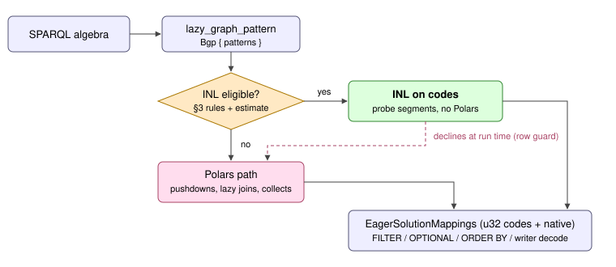
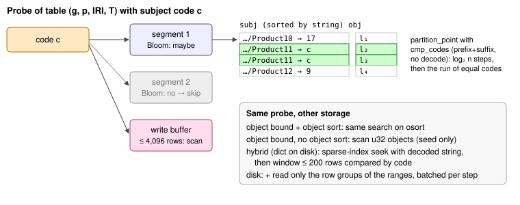
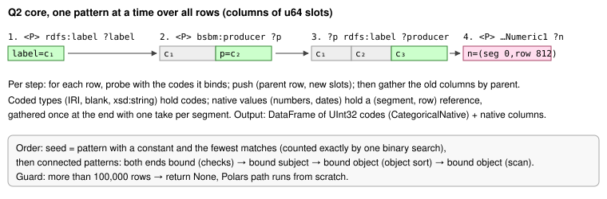

# Index nested-loop BGPs on dictionary codes (design, proposal K)

Status: **design for approval**, with a prototype of the core. Nothing here is landed.
Branch `claude/gifted-shannon-c1ada8`, based on main `056247e9`.

## Summary

- **Goal.** Evaluate the small, selective basic graph patterns (BGPs) that dominate BSBM explore
  outside Polars. Each pattern is answered by probing the sorted segments of its table with the
  dictionary codes that the earlier patterns bound. Values are decoded only at the end, by the
  existing result writer.
- **Why.** On main, explore runs at about 8.2k QMpH estimated on the benchmark's hardware,
  against TripleTrail's 70.4k. Its profile is 42% pushdowns (codes decoded to `oxrdf::Term` and
  back) and 36% collects, for BGPs that touch tens to thousands of rows. An index nested loop
  (INL) does neither: no terms, no lazy plan, no Polars optimizer, no thread-pool hand-off.
- **Prototype.** `lib/triplestore/src/storage/inl.rs` (about 500 lines), behind `MAPLIB_INL=1`.
  It covers in-memory storage, constant predicates, one table per pattern, star and chain BGPs of
  any length, coded and native object values, the write buffer and the Bloom filters.
- **Measured** (in-process, BSBM 2785, see [Prototype numbers](#prototype-numbers)):
  full Q2 **5.90 → 2.28 ms (2.6×)**, full Q1 **1.42 → 0.57 ms (2.5×)**,
  full Q7 7.15 → 6.04 ms (its two OPTIONAL groups still run in Polars); the Q2 star-and-chain
  core 1.04 → 0.27 ms (3.9×). Results identical on all 350 checked queries.
- **Expected gain.** Stage 1 alone takes the local explore mix from about 106 to 71 ms
  (1.5×, roughly 8.2k → 12k QMpH estimated on the benchmark's hardware). With OPTIONAL and
  FILTER inside INL (stages 2–3) about 40 ms (2.7×, ~22k), and with the per-query floor work
  (proposal D) about 34 ms (3.1×, ~26k). TripleTrail's 70.4k stays out of reach on this
  benchmark's Python wrapper alone; see the risks.
- **Ask.** Approval of the staged plan below. Stage 1 is a contained change (the prototype made
  production-ready, with fallbacks, tests and the Oxigraph comparison). Stages 2–4 widen it.

## 1. Where the time goes today

From the per-query analysis (`tripletrail_query_analysis.md`, "BSBM 2785"), local AQET in ms on
`7093998f` and the share of the explore mix:

| query | n/mix | TT (ccx43) | local 7093998f | maplib time share | shape |
|---|---:|---:|---:|---:|---|
| Q1 | 1 | 1.23 | 1.93 | 2% | star of 5 from two constant objects, FILTER, ORDER BY LIMIT |
| Q2 | 6 | 2.14 | 6.09 | 37% | star of 12 on a constant product, 2 chains, 3 OPTIONALs |
| Q3 | 1 | 1.38 | 2.75 | 3% | Q1 + OPTIONAL/!BOUND |
| Q4 | 1 | 1.53 | 3.60 | 3% | UNION of two Q1-like stars |
| Q5 | 2 | 2.06 | 4.63 | 8% | star + range FILTER on two numeric values |
| Q7 | 4 | 1.70 | 7.39 | 28% | constant product, 2 OPTIONAL chains (offers, reviews) |
| Q8 | 2 | 2.84 | 6.55 | 12% | reviews of a product, FILTER langMatches, ORDER BY LIMIT |
| Q10 | 2 | 1.47 | 3.59 | 6% | offers of a product, FILTER on date and country |
| Q11 | 1 | 0.88 | 2.28 | 2% | `<offer> ?p ?o` UNION `?s ?p <offer>` |

Q2 and Q7 are 65% of maplib's explore time. Both start from one constant product and read a
few dozen triples. Today each triple pattern is a separate lazy frame: the earlier patterns'
solutions are collected, their values are turned into `HashSet<Term>` pushdowns, the codes are
looked up again for the Bloom filters and the sparse index, and the next pattern's frame is
joined in Polars. bgp-codes (in flight) removes the pushdown round trip for small tables and
joins in the plan; the per-pattern planning and collect remain.

## 2. TripleTrail, for reference

From TripleTrail's public code and docs (`crates/tripletrail-store/src/bgp.rs`,
`crates/tripletrail/src/idtree.rs`, `docs/store.md`, `docs/architecture.md`); ideas only:

- **Joins on ids inside the store.** `Snapshot::join_ids` joins the triple patterns one at a
  time, always taking the cheapest next one. Each candidate step is costed as a scan, an index
  nested loop (rows × a lookup cost of 40 against a scan cost of 1 per triple), a merge join
  (or a galloping "seek" join when the scan is already sorted on the key), or a hash join when
  several variables are shared.
- **`join_ids_from`: the small side probes the large side.** When an operator above the BGP
  already has a small table of bindings, its distinct values seed the BGP's probes, but only if
  rows × 40 is below the scan estimate.
- **Fanout from stored statistics.** Per predicate, the sum of squares of triples per subject and
  per object gives the expected fanout of a probe. TripleTrail credits this with explore going
  from 34k to 87k QMpH.
- **Bindings** are row-major `Vec<TermId>` tables (width = number of variables, 0 = unbound),
  read in chunks; there is no fixed batch size. A size budget (join memory / 8 bytes of ids)
  makes it give up and let the general evaluator run.
- **Filters on ids** become per-row kernels: BOUND, `&&`/`||`/`!`, `sameTerm`, `=` on ids,
  comparisons of inline numbers and dates, isIRI/isLiteral, LANG/langMatches, prefix REGEX via
  string ranks. A kernel that cannot decide on ids hands the query back.
- **Hand-back.** Anything the id evaluator does not cover returns None and the general evaluator
  (Oxigraph's) runs. Ids are decoded only for LANG/DATATYPE and text functions, cached per id.
- **Cancellation** is a callback checked every 4,096 rows, 65,536 output ids or 1,024 steps.
- **Writes** go to a sorted persistent delta (`imbl::OrdSet`) that every scan merges in, and that
  is folded into segments at 65,536 quads.

maplib differs in two ways that shape this design: its triples are partitioned by predicate and
by subject and object type (so the "permutations" are a subject sort per table, and an object
sort for some predicates), and its segments are sorted by the **strings** of the codes, not by
the codes.

## 3. When to choose INL



INL is chosen per BGP, before the Polars path, when all of these hold:

1. **No incoming solutions, or few.** Either the BGP starts the group (no solution mappings), or
   the incoming solutions are eager and small (stage 3: `join_ids_from`).
2. **Every pattern has a constant predicate**, and its subject and object are constants or
   variables (blank nodes are variables; stage 2).
3. **The BGP is connected from a seed.** Some pattern has a constant subject or object (or a
   variable bound by incoming solutions), and every later pattern shares a variable with the
   patterns before it. A cross product falls back.
4. **The estimated work is small.** With the row-estimation statistics (`cardinality-estimates`,
   `TableStats`): starting from the seed's estimated rows `r₀`, each step multiplies by the
   pattern's fanout, `rows/distinct_subjects` for a bound subject and `rows/distinct_objects` for
   a bound object (`max_subject_rows` / `max_object_rows` as upper bounds). INL is chosen when
   the bound on the total number of probes `Σ rᵢ` is under `INL_MAX_PROBES` (proposed 20,000)
   and no intermediate bound exceeds `INL_MAX_ROWS` (100,000). Without statistics, the table
   heights and the Bloom filters bound it: a constant subject probe gives at most
   `max_subject_rows`.
5. **A bound object needs an object sort or a small table.** Probing a bound object on a table
   without an object sort scans its object column. That is allowed for the seed when the table
   has at most `INL_MAX_SCAN` rows (proposed 200,000 u32 compares, about 50 µs) and never inside
   the loop, unless the per-segment code postings of stage 2 exist.
6. **A run-time guard.** If the bindings grow past `INL_MAX_ROWS` while running, INL stops and
   the Polars path starts again from scratch. That wastes the work done, but the estimate rules
   it out in practice, and it keeps the fallback exact.

For BSBM explore, every BGP passes 1–5: the seeds are one product (Q2, Q7, Q8, Q10, Q11) or a
product type and two features (Q1, Q3, Q4, Q5), and the largest intermediate is a few hundred
products.

## 4. Data structures and probes

### 4.1 A table as slices

A table is (graph, predicate, subject type, object type), with sorted segments and a write
buffer. For INL each segment is viewed as borrowed slices, without copying:

- `subj: &[u32]`: subject codes, sorted by their strings;
- `obj: &Column` and, for coded objects, `obj_codes: &[u32]`, aligned with `subj`;
- `osort: Option<(&[u32], &[u32])>`: the object sort's objects (sorted by string) and subjects;
- the segment's subject and object Bloom filters.

The buffer (up to 4,096 unsorted rows) is one more "segment" that is scanned instead of searched.

### 4.2 Probing by code



Codes are global per type, and equal strings have equal codes, but segments are sorted by
string. The sparse index (every 100th row) is keyed by `Arc<String>`, so seeking it needs the
target's string. INL instead binary-searches the code column directly, comparing codes by their
strings **without decoding**: the in-memory dictionary stores each string as an interned prefix
and a suffix, and the comparison walks the two parts (`CatMapsInMemory::cmp_codes`, added for the
prototype). A probe is

1. the Bloom filter (`may_hold_code`), which skips almost every segment that lacks the code;
2. `partition_point` on `subj` with the string comparison: about log₂(rows) comparisons, each
   two slot lookups and a short byte comparison (identical interned prefixes compare by pointer);
3. a forward scan of the run of equal codes.

For a bound object the same is done on `osort` when the predicate has an object sort
(`rdfs:label` and `rdf:type` by default), and otherwise the object column is scanned with a plain
`u32` comparison.

**Alternatives considered.**
- *The sparse index* (sparse-index seek, `local_a835595a`, lands soon): seek with the target's
  decoded string, then scan the ≤ 200 rows between two keys for the code. It needs one decode
  and one `String` per probe, but no in-memory dictionary, so it is **the probe for the on-disk
  dictionary** (hybrid and disk modes, §4.6).
- *Global ranks* (`RankMap`, cached in the dictionary): binary search on `rank[code]`. Fastest
  per comparison, but the cache is dropped when new strings are added, and rebuilding it sorts
  the whole dictionary. Under BSBM's explore-and-update mix that happens every few queries, so
  ranks are only used when already cached.
- *Code postings per segment* (stage 2): a lazily built `(code, first row)` array sorted by code,
  in a `OnceLock` on the segment (segments are immutable, so it never goes stale). It turns a
  probe into a binary search on `u32`s, and gives bound-object probes on tables without an object
  sort: `(object code, row)` pairs, 8 bytes per row. Built only for tables that INL probes by
  object more than a few times.

### 4.3 Deletes

In memory, deletes cut slices out of a segment's frame; the columns may then have up to 32
chunks. The prototype needs one chunk (`cont_slice`) and falls back otherwise; stage 1 iterates
the chunks (a binary search per chunk, or the chunk offsets as a tiny index). The Bloom filters
stay supersets after deletes, which is still correct. On disk, a `DiskView` keeps row ranges of
the file; the probe reads only the row groups of the ranges it finds (§4.6).

### 4.4 Named graphs and datasets

A BGP is evaluated against one `QueryGraph`. For a named graph, or a dataset whose default graph
is one graph, INL uses that graph's tables. For a default graph that is the merge of several
graphs, every pattern unions the tables of the graphs, which is the same as one more set of
segments per table, and the distinct of the merge is applied at the end (rows that occur in
several graphs). `GRAPH ?g { … }` binds `?g` per table and is stage 3.

### 4.5 Mixed types

A predicate can have several tables with different subject or object types (e.g. `rdfs:label`
with `xsd:string` and `rdf:langString`). The prototype keeps one table per pattern after the
types of the constants and of the already bound variables are applied, and falls back
otherwise. Stage 2 tags every slot with its type: a variable holds a `(type id, code)` pair, a
pattern probes every compatible table, and the output is one frame per combination of types,
concatenated into the existing multi-type columns by the same code that builds them for triple
patterns today (`create_prefixed_multi_colname`, `unnest_non_multi_col`). Language-tagged
strings are stored as two codes (value, language) and are handled like a type with a pair of
codes.

### 4.6 Storage modes

| mode | triples | dictionary | INL probe |
|---|---|---|---|
| in-memory | frames in memory | in memory | binary search by string order on the slices (prototype) |
| hybrid | frames in memory | on disk | sparse-index seek with the decoded target string; window scan on codes |
| disk | parquet files (`TriplesOnDisk`, `DiskView`), possibly remote | on disk | sparse-index seek, then read only the row groups of the found ranges, batched over all probes of a step |

For disk mode the probes of one step are sorted and batched, so each row group is read once per
step (the same coalescing as `coalesce_lookup_ranges`). A remote table that is not downloaded
yet makes INL fall back, so that a selective query does not download a large table on the
critical path in a loop.

## 5. Pattern order and bindings

### 5.1 Order

Greedy, like TripleTrail's: start from the seed with the fewest estimated rows, then always take
a connected pattern, preferring (1) patterns whose subject and object are both bound (pure
checks, fanout ≤ 1), (2) bound subjects (fanout `rows/distinct_subjects`, about 1 for most BSBM
predicates), (3) bound objects with an object sort, (4) bound objects by scan. With statistics the
tie-break is the estimated fanout. The prototype estimates the seed by counting its matches
exactly (one binary search), which is cheaper than consulting statistics and exact.

### 5.2 Bindings: columnar slots, one pattern at a time



The bindings are columns of `u64` slots, one per variable:

- a dictionary code for variables of coded types (IRIs, blank nodes, `xsd:string`);
- a packed (segment, row) reference for a variable bound to a native value (numbers, dates,
  booleans), pointing into the table of the pattern that bound it. Native values are gathered
  once, at the end, with a `take` per segment. A join or a FILTER on a native value reads it
  through the reference.

Each pattern is applied to all current rows (breadth-first): for each row, probe, and push the
parent row index and the new slots. The old columns are then gathered by the parent indices.
This keeps the inner loop tight (no per-row allocation, no recursion), makes the run-time guard
trivial, and gives Polars-ready columns at the end.

Depth-first (row at a time) is better only under `LIMIT` without `ORDER BY`, where it can stop
early; that is stage 4 and needs the hand-back to know the LIMIT.

## 6. FILTER, OPTIONAL and the hand-back

- **Hand-back point.** INL returns an `EagerSolutionMappings`: `UInt32` columns of codes with
  `CategoricalNative` state, and native columns as stored. The rest of the query (FILTER,
  OPTIONAL with values, ORDER BY, projection, result writing) runs on it unchanged, and the codes
  are decoded by the result writer as they are today.
- **FILTER inside the BGP's group** (stage 2): simple kernels pushed into the loop right after the
  pattern that binds their last variable:
  `?a = ?b`/`sameTerm` and `!=` on codes; `= <iri>`; comparisons of a native value with a
  constant (Q1's `?value1 > x`, Q5's ranges, Q10's date); `BOUND`; `isIRI`/`isLiteral`.
  Anything else is applied by Polars after the hand-back, which is always correct.
- **OPTIONAL** (stage 3): a left join whose right side is a BGP is the same loop with
  "emit the row unbound if no match". Q7's two OPTIONAL groups and Q2's three OPTIONALs then run
  inside INL. An OPTIONAL with a FILTER keeps the filter in the left-join condition: kernel if
  possible, otherwise hand back the whole left join.
- **UNION** (stage 3): each branch is its own INL BGP; the results are concatenated.

## 7. Parallelism and cancellation

- **Single-threaded by design.** The BGPs INL takes are a few thousand probes; fanning out costs
  more than it saves, and avoiding Polars' pool hand-off is part of the gain. A step with more
  than `INL_PAR_ROWS` (proposed 16,384) rows is split into chunks of rows probed on the rayon
  pool, each chunk with its own output buffers, concatenated in order.
- **Cancellation.** `utils::cancel::check()` every 4,096 probed rows (and per step), as
  TripleTrail does, and the `max_rows` / memory budget of the query (`max_memory_mb`) is checked
  against the binding size at each step.

## 8. How it composes with the in-flight work

- **BGPs on codes (`local_ef360764`, bgp-codes).** Complementary. bgp-codes makes the Polars path
  cheaper for BGPs that INL does not take (small tables joined in the plan, one collect), and its
  height estimates decide the engine of the final collect. INL is tried first; when it declines,
  bgp-codes' path runs. Shared pieces: its static emptiness check runs before INL, and its
  OPTIONAL-with-values evaluation is the hook for stage 3's `join_ids_from`.
- **Code pushdowns (`local_af1bce9d`).** Pushdowns of codes instead of terms are what INL's
  stage 3 consumes as a seed: a small set of codes for a variable becomes the first column of the
  bindings. Without INL, they make the Polars path cheaper; with it, the seed costs nothing to
  build.
- **Count-only joins (`local_f2885d7c`).** Same data access (per-table codes), different
  output: count-joins sums weights over the join tree without building rows. They should share
  the table view and the probe (`TableView`, `equal_range`), and the analysis's B2 proposal
  (small-side probes into the large side) is exactly INL's probe. Order: count-joins is tried
  first for `COUNT(*)`; INL covers the rest.
- **Fixed per-query cost (`local_2a0bf4db`).** Multiplicative. INL removes the BGP's collects;
  the per-query floor (1 GB stack per query, pool hand-off of the final collect, optimizer) is
  then most of what is left: on the prototype's Q2 shape the floor is 0.23 ms for the 2-pattern star, of which INL is a few microseconds and the rest is the floor (`SELECT * { VALUES ?x {1} }` takes 0.18 ms). Collecting small
  plans synchronously on the calling thread (proposal D) matters more once INL is in.
- **Row estimation (`local_e9aadebc`, `cardinality-estimates`).** INL's choice (§3) and order
  (§5.1) read `TableStats`; until it lands, table heights and `max_*_rows` are enough for BSBM.
- **Sparse-index seek (`local_a835595a`).** The probe for the on-disk dictionary (§4.6).

## Prototype

`lib/triplestore/src/storage/inl.rs`, called from the BGP branch of `lazy_graph_pattern` when
`MAPLIB_INL=1`, the BGP has no incoming solutions and no `maplib:path` patterns, and the dataset
is one graph. It returns `None` (the Polars path runs) for anything outside its scope, including
empty results (so that the typed empty frame is built as today).

The probe (string order without decoding, then the run of equal codes):

```rust
fn equal_range(&self, sorted: &[u32], code: u32) -> std::ops::Range<usize> {
    let lo = sorted.partition_point(|c| self.cmp(*c, code) == Ordering::Less);
    let mut hi = lo;
    while hi < sorted.len() && sorted[hi] == code {
        hi += 1;
    }
    lo..hi
}
```

One step of the loop, for a pattern with a bound subject (abridged):

```rust
for row in 0..n_rows {
    let s = get(p.s, row);                       // code from a constant or a bound column
    for (si, seg) in p.view.segs.iter().enumerate() {
        if seg.seg.is_some_and(|sg| !sg.may_hold_code(s, false)) {
            continue;                            // Bloom filter: not in this segment
        }
        let range = if seg.seg.is_some() { s_order.equal_range(seg.subj, s) }
                    else { 0..seg.subj.len() };  // the write buffer is scanned
        for r in range.filter(|r| seg.subj[*r] == s) {
            parent.push(row as u32);
            new_o.push(if o_coded { seg.obj_codes.unwrap()[r] as u64 } else { pack(si, r) });
        }
    }
}
for c in cols.iter_mut().flatten() {             // gather the old columns by parent row
    *c = parent.iter().map(|r| c[*r as usize]).collect();
}
```

The hook in `lazy_graph_pattern` (`GraphPattern::Bgp`), before the pushdowns are added:

```rust
if solution_mappings.is_none() && length_paths.is_empty() && inl::inl_enabled() {
    if let Some(g) = /* the one stored graph of the dataset */ {
        if let Some(sm) = inl::inl_bgp(&patterns, g, &self.global_cats.read()?) {
            return Ok(sm.as_lazy());
        }
    }
}
```

`MAPLIB_INL_DEBUG=1` prints why INL declined. The first timing run found that the object
sorts of `rdfs:label` and `rdf:type` are not one chunk after a read (the sort's output), which
made the prototype decline every BGP using them; it now scans the object column instead, and
stage 1 iterates chunks.

### Prototype numbers

In-process, BSBM 2785 in memory, one Python process, `m.query(q, cache=False)`; 50 parameter
sets (random products with a type and two features), one warm-up pass, then 5 rounds; median
of the 250 timings per query. "before" is the clean `7093998f` release-test build (same
open-source engine as the base `056247e9`); "INL off/on" is this branch's build with
`MAPLIB_INL=0/1` in the same process. Status quiet window, load 4.5–4.8.

| query | what | before | INL off | INL on | on ÷ off |
|---|---|---:|---:|---:|---:|
| `q2_star2` | `<P> rdfs:label ?l . <P> rdfs:comment ?c` | 0.33 | 0.27 | 0.23 | 0.86 |
| `q2_star_chain` | `<P>` label, producer, producer's label, numeric1 (native) | 1.02 | 1.04 | **0.27** | 0.26 |
| `q1_star` | `?p a <T> . ?p productFeature <F> . ?p rdfs:label ?l` | 0.87 | 0.89 | **0.41** | 0.46 |
| `q7_chain` | `?o bsbm:product <P> . ?o bsbm:vendor ?v . ?v rdfs:label ?vt` | 1.37 | 1.43 | **0.64** | 0.45 |
| full Q1 | 5-pattern star, FILTER, ORDER BY LIMIT 10 | 1.44 | 1.42 | **0.57** | 0.40 |
| full Q2 | 12-pattern star + chains, 3 OPTIONALs | 6.05 | 5.90 | **2.28** | 0.39 |
| full Q7 | label + 2 OPTIONAL chains with a FILTER | 7.77 | 7.15 | 6.04 | 0.85 |

(p10/p90 with INL on: full Q2 2.04/2.52, full Q1 0.51/0.70, `q2_star_chain` 0.23/0.33.)

- **Correctness.** Every one of the 350 timed queries was run with INL off and on and the bags
  of solutions compared: no differences. Peak RSS 726 MB.
- **Where the remaining time is.** The 2-pattern star is at the per-query floor (0.18 ms for
  `VALUES ?x {1}`). In full Q2 the 12 patterns now cost well under 0.1 ms; the 2.28 ms are the
  three OPTIONALs (each a Polars left join with pushdowns) and the floor. In full Q7 the two
  OPTIONAL groups are almost all of the 6 ms: stage 3.
- **Not covered by the prototype:** `q1_star` and `q7_chain` scan the object column of
  `rdf:type`/`bsbm:product` (no usable object sort); with the chunked object sort (stage 1) and
  code postings (stage 2) they drop further.
- **First run.** The first window showed no gain: `MAPLIB_INL_DEBUG=1` then showed that every
  BGP with `rdfs:label` or `rdf:type` declined on the multi-chunk object sort. Fixed, rebuilt,
  re-timed in a second window.

## Expected gain per BSBM explore query

Model: the local AQET of `7093998f` through the benchmark's wrapper (analysis table), minus the
in-process saving per query, measured where the prototype ran it (Q1, Q2, Q7) and estimated
from the shape otherwise. The ccx43 column scales the analysis's 8.2k QMpH by the mix-time
ratio, which is crude for queries near the floor.

| query | n/mix | today (ms) | stage 1 | how | + stages 2–3 | how |
|---|---:|---:|---:|---|---:|---|
| Q1 | 1 | 1.93 | 1.08 | measured −0.85 | 0.9 | FILTER kernel |
| Q2 | 6 | 6.09 | 2.47 | measured −3.62 | 1.6 | OPTIONALs in INL |
| Q3 | 1 | 2.75 | 1.9 | as Q1 | 1.4 | OPTIONAL/!BOUND |
| Q4 | 1 | 3.60 | 2.1 | two Q1 stars (UNION branches) | 1.8 | |
| Q5 | 2 | 4.63 | 3.1 | product star joined on features | 2.5 | range FILTER kernel |
| Q7 | 4 | 7.39 | 6.29 | measured −1.10 | 2.3 | both OPTIONAL chains in INL |
| Q8 | 2 | 6.55 | 6.55 | lang-string titles decline | 3.0 | lang strings (stage 2), OPTIONAL ratings |
| Q10 | 2 | 3.59 | 2.3 | offers chain, native values | 1.9 | date/country FILTER kernels |
| Q11 | 1 | 2.28 | 2.28 | variable predicate: not INL | 2.28 | |
| **mix** | 20 | **106** | **71** | | **40** | |
| local QMpH | | 34k | 51k | | 90k | |
| est. ccx43 QMpH | | 8.2k | 12k | | 22k | 26k with proposal D (≈ −0.3 ms × 20) |

TripleTrail is 70.4k on the ccx43. The analysis attributes much of the ×3.9 local-to-published
scale to the benchmark's Python `http.server` wrapper and its JSON-to-XML conversion; INL cannot
remove that, `Model.serve` (Rust) would.

## Risks

1. **Two evaluators for one BGP.** Every BGP INL takes must give the same bag of solutions as
   the Polars path. Mitigation: INL returns `None` for anything outside its scope instead of
   approximating; a differential test runs every BGP of the W3C suite, the BSBM templates and
   the `test_bgp_star_chain.py` shapes both ways and compares bags; the Oxigraph comparison of
   bgp-codes covers stars and chains.
2. **Bad choices on skewed data.** A seed or fanout that the estimate gets wrong makes INL probe
   far more rows than a hash join would scan. Mitigation: the `INL_MAX_PROBES`/`INL_MAX_ROWS`
   guards abort early (the wasted work is bounded by the guard), and `max_*_rows` bounds are
   exact upper bounds per key.
3. **String-order comparisons.** The binary search relies on segments being sorted by the same
   byte order that `cmp_codes` uses. This holds for the rank-based and the compacted sorts
   (both derive from the dictionary's sorted slots), but a future change of sort order would
   silently break probes. Mitigation: a debug assertion that the found run is preceded and
   followed by different codes, and a test that probes every subject of a random table.
4. **Dictionary rank cache invalidation.** Avoided by not depending on ranks (§4.2).
5. **Deleted rows and chunked columns** (§4.3): the prototype falls back; stage 1 must handle
   chunks, or INL silently stops applying after deletes (a performance, not a correctness,
   risk; a counter in `debug` output shows how often INL declines and why).
6. **Mixed-type variables** fall back until stage 2. In BSBM none occur; in user data
   (`rdfs:label` with languages, `schema:value` of several types) they are common, so stage 2
   decides whether INL helps outside benchmarks.
7. **Memory.** The bindings are 8 bytes per variable per row, capped by `INL_MAX_ROWS`
   (100,000 rows × 15 variables = 12 MB). The code postings of stage 2 are 8 bytes per row of
   the tables they are built for, kept per segment.
8. **The estimates for Q3–Q10 are not measured.** Only Q1, Q2 and Q7 (and their cores) were
   timed; the other rows of the gain table are modelled from their shapes. Stage 1's merge
   request benchmarks the whole explore mix through the benchmark's driver.
10. **The floor dominates after INL.** Once the BGPs cost microseconds, the per-query floor
   (stack, final collect, optimizer, JSON) is most of the query; without proposal D the explore
   gain is limited (see the expected-gain table).
9. **Interaction with in-flight branches.** bgp-codes and code pushdowns change the same BGP
   branch; INL is a separate early return and touches no shared code, so conflicts are textual
   only.

## Staged implementation plan

| stage | scope | done when | size |
|---|---|---|---|
| **1. INL for seeded BGPs in memory** | the prototype made production-ready: chunked columns after deletes, empty results with typed columns, blank-node variables, the default graph of one graph, the §3 choice with table heights and `max_*_rows`, cancellation checks, `debug` output saying why INL declined; switched on by default with `MAPLIB_INL=0` to turn it off | differential tests (W3C, BSBM templates, `test_bgp_star_chain.py`) equal; BSBM explore before/after in a quiet window | ~800 lines + tests |
| **2. Types, filters, postings** | slots tagged with types for mixed-type variables and lang strings; FILTER kernels (§6) inside the loop; per-segment code postings for bound objects without an object sort; row-estimation statistics for the choice and order once `cardinality-estimates` lands | Q1, Q3, Q5, Q10 run their BGP and FILTER in INL; tests for mixed types | ~900 lines |
| **3. OPTIONAL, UNION, seeds from solutions** | left joins and unions of BGPs inside INL; small eager incoming solutions or code pushdowns as seeds (`join_ids_from`); merged default graphs; `GRAPH ?g` | Q2, Q7, Q8 entirely in INL up to ORDER BY / projection | ~800 lines |
| **4. Storage modes, LIMIT** | hybrid (sparse-index seek on the on-disk dictionary) and disk (batched row-group reads); depth-first evaluation under LIMIT without ORDER BY; parallel steps past `INL_PAR_ROWS` | disk/hybrid tests; BSBM in hybrid mode | ~600 lines |

Each stage is a separate merge request with its own PDF and benchmark. Stage 1 is useful on its
own (it takes the main BGP of every explore query); stages 2 and 3 take the rest of explore's
BGP work; stage 4 is for users of the other storage modes and can wait.
